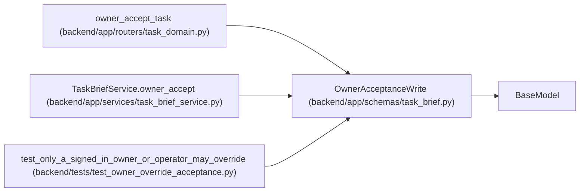

# OwnerAcceptanceWrite

**Location:** `backend/app/schemas/task_brief.py:90`
**Kind:** Pydantic model
**Bases:** `BaseModel`
**Module:** [schemas_task_brief](../modules/schemas_task_brief.md)

## Description

An owner's acceptance of one resolved task without a verified review publisher.

## Model Configuration

| Setting | Value | Source |
|---------|-------|--------|
| `extra` | `'forbid'` | model_config |

## Validators

| Method | Scope | Fields | Mode | Options |
|--------|-------|--------|------|---------|
| `reason_has_content` | field | reason | after | — |

## Attributes

| Name | Type | Wire name | Required | Nullable | Default | Constraints | Examples | Description |
|------|------|-----------|----------|----------|---------|-------------|-------------|----------|
| `expected_version` | `int` | `expected_version` | Yes | No | — | ge=1 | — | — |
| `brief_revision` | `int` | `brief_revision` | Yes | No | — | ge=0 | — | — |
| `artifact_revision` | `int` | `artifact_revision` | Yes | No | — | ge=0 | — | — |
| `reason` | `str` | `reason` | Yes | No | — | max_length=2000; min_length=1 | — | Why the owner accepts this work without an independent publisher review. |
| `evidence` | `str` | `evidence` | No | No | `''` | max_length=8000 | — | — |

## Methods

| Method | Signature | Decorators | Description |
|--------|-----------|------------|-------------|
| `reason_has_content` | `(value)` | `@field_validator('reason')`, `@classmethod` | — |

## Relationships

<!-- Auto-generated relationship summary. Do not edit by hand. -->

### Summary

| Module | Methods | Attributes |
|---|---:|---|
| [schemas_task_brief](../modules/schemas_task_brief.md) | 1 | `artifact_revision`, `brief_revision`, `evidence`, `expected_version`, `reason` |

### Structure

| Kind | Entity | Module |
|---|---|---|
| Base | `BaseModel` | — |

### References

| Reference | Kind | Source | Call sites |
|---|---|---|---:|
| `owner_accept_task` | type_reference | [routers_task_domain](../modules/routers_task_domain.md) | — |
| `TaskBriefService.owner_accept` | type_reference | [task_brief_service](../modules/task_brief_service.md) | — |
| `test_only_a_signed_in_owner_or_operator_may_override` | call | [test_owner_override_acceptance](../modules/test_owner_override_acceptance.md) | 1 |
