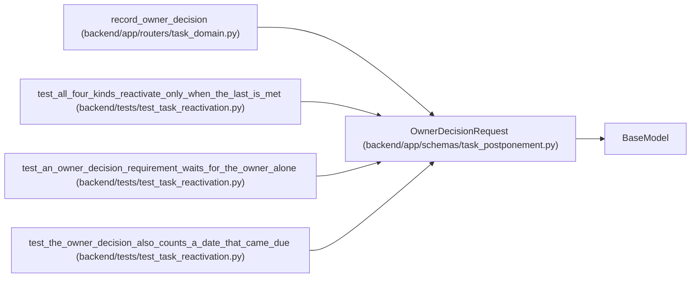

# OwnerDecisionRequest

**Location:** `backend/app/schemas/task_postponement.py:97`
**Kind:** Pydantic model
**Bases:** `BaseModel`
**Module:** [schemas_task_postponement](../modules/schemas_task_postponement.md)

## Description

Record that the owner made the decision an owner_decision requirement waits for.

Only the workspace owner can record it, and the postponed work returns to its
lifecycle when this was the last unmet requirement.

## Model Configuration

| Setting | Value | Source |
|---------|-------|--------|
| `extra` | `'forbid'` | model_config |

## Validators

| Method | Scope | Fields | Mode | Options |
|--------|-------|--------|------|---------|
| `_decision` | field | decision | after | — |

## Attributes

| Name | Type | Wire name | Required | Nullable | Default | Constraints | Examples | Description |
|------|------|-----------|----------|----------|---------|-------------|-------------|----------|
| `expected_version` | `int` | `expected_version` | Yes | No | — | ge=1 | — | — |
| `decision` | `str` | `decision` | Yes | No | — | max_length=2000; min_length=1 | — | What the owner decided. |

## Methods

| Method | Signature | Decorators | Description |
|--------|-----------|------------|-------------|
| `_decision` | `(value: str) -> str` | `@field_validator('decision')`, `@classmethod` | — |

## Relationships

<!-- Auto-generated relationship summary. Do not edit by hand. -->

### Summary

| Module | Methods | Attributes |
|---|---:|---|
| [schemas_task_postponement](../modules/schemas_task_postponement.md) | 1 | `decision`, `expected_version` |

### Structure

| Kind | Entity | Module |
|---|---|---|
| Base | `BaseModel` | — |

### References

| Reference | Kind | Source | Call sites |
|---|---|---|---:|
| `record_owner_decision` | type_reference | [routers_task_domain](../modules/routers_task_domain.md) | — |
| `test_all_four_kinds_reactivate_only_when_the_last_is_met` | call | [test_task_reactivation](../modules/test_task_reactivation.md) | 1 |
| `test_an_owner_decision_requirement_waits_for_the_owner_alone` | call | [test_task_reactivation](../modules/test_task_reactivation.md) | 2 |
| `test_the_owner_decision_also_counts_a_date_that_came_due` | call | [test_task_reactivation](../modules/test_task_reactivation.md) | 1 |
