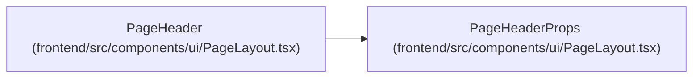

# PageHeaderProps

**Location:** `frontend/src/components/ui/PageLayout.tsx:26`
**Kind:** Type alias
**Bases:** —
**Module:** [PageLayout](../modules/PageLayout.md)
**Target:**

```typescript
{
    title: ReactNode;
    /** One sentence saying what the page is for. */
    purpose?: ReactNode;
    /** The one action the page leads with. A second one is refused in development. */
    primaryAction?: ReactNode;
    /** Up to two supporting actions. */
    secondaryActions?: ReactNode;
    /** Every further page-level action, shown in one overflow menu. */
    overflowItems?: OverflowMenuItem[];
    /** A control that sets the scope of the page, placed before the actions. */
    context?: ReactNode;
    /** Pre-built overflow control, for callers that already own the menu. */
    overflow?: ReactNode;
    meta?: ReactNode;
    className?: string;
    /** @deprecated Use `purpose`. */
    subtitle?: ReactNode;
    /** @deprecated Use `primaryAction`, `secondaryActions` and `overflowItems`. */
    actions?: ReactNode;
    /**
     * Compatibility path for pages that still hand over more than two supporting
     * actions: the secondary slot is rendered exactly as given. The one-primary
     * limit is not affected. New pages must not set it.
     */
    unlimitedSecondaryActions?: boolean;
}
```

## Description

_Auto-generated from `PageHeaderProps` in `frontend/src/components/ui/PageLayout.tsx`._

## Attributes

*See the alias definition for its member types.*

## Methods

*See the alias definition for callable and member types.*

## Relationships

<!-- Auto-generated relationship summary. Do not edit by hand. -->


### Summary

| Module | Methods | Attributes |
|---|---:|---|
| [PageLayout](../modules/PageLayout.md) | 0 | — |

### References

| Reference | Kind | Source | Call sites |
|---|---|---|---:|
| `PageHeader` | type_reference | [PageLayout](../modules/PageLayout.md) | — |
