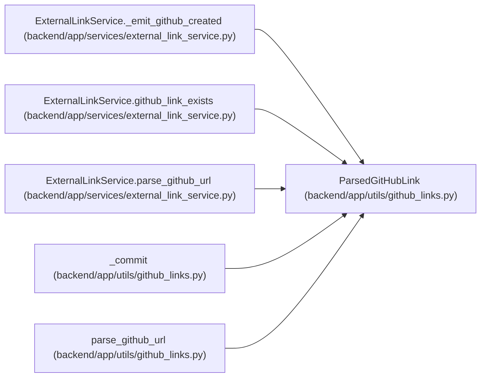

# ParsedGitHubLink

**Location:** `backend/app/utils/github_links.py:22`
**Kind:** Class
**Bases:** —
**Module:** [github_links](../modules/github_links.md)

**Decorators:** `@dataclass(frozen=True)`

## Description

Normalized GitHub link details ready for persistence.

## Attributes

| Name | Type | Default | Description |
|------|------|---------|-------------|
| `github_type` | `str` | *required* | — |
| `owner` | `str` | *required* | — |
| `repo` | `str` | *required* | — |
| `repo_full_name` | `str` | *required* | — |
| `number` | `Optional[int]` | *required* | — |
| `branch` | `Optional[str]` | *required* | — |
| `external_key` | `str` | *required* | — |
| `url` | `str` | *required* | — |
| `title` | `str` | *required* | — |
| `sha` | `Optional[str]` | `None` | — |
| `tag` | `Optional[str]` | `None` | — |

## Methods

| Method | Signature | Decorators | Description |
|--------|-----------|------------|-------------|
| `metadata_json` | `() -> dict[str, Any]` | `@property` | Return the public metadata stored with the external link. |

## Relationships

<!-- Auto-generated relationship summary. Do not edit by hand. -->

### Summary

| Module | Methods | Attributes |
|---|---:|---|
| [github_links](../modules/github_links.md) | 1 | `branch`, `external_key`, `github_type`, `number`, `owner`, `repo`, `repo_full_name`, `sha`, `tag`, `title`, `url` |

### References

| Reference | Kind | Source | Call sites |
|---|---|---|---:|
| `ExternalLinkService._emit_github_created` | type_reference | [external_link_service](../modules/external_link_service.md) | — |
| `ExternalLinkService.github_link_exists` | type_reference | [external_link_service](../modules/external_link_service.md) | — |
| `ExternalLinkService.parse_github_url` | type_reference | [external_link_service](../modules/external_link_service.md) | — |
| `_commit` | call | [github_links](../modules/github_links.md) | 1 |
| `_commit` | type_reference | [github_links](../modules/github_links.md) | — |
| `parse_github_url` | call | [github_links](../modules/github_links.md) | 4 |
| `parse_github_url` | type_reference | [github_links](../modules/github_links.md) | — |
