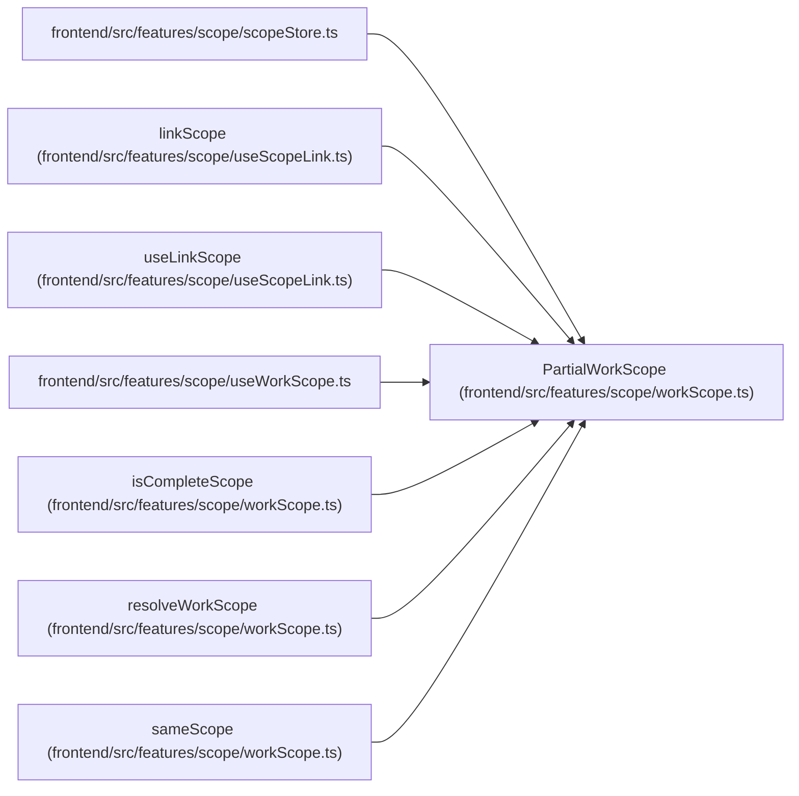

# PartialWorkScope

**Location:** `frontend/src/features/scope/workScope.ts:16`
**Kind:** Interface
**Bases:** —
**Module:** [workScope](../modules/workScope.md)

## Description

A scope that may be incomplete: read from the URL, remembered, or just chosen.

## Attributes

| Name | Type | Required | Default | Description |
|------|------|----------|---------|-------------|
| `project` | `ScopeProject \| null` | No | — | — |
| `iteration` | `ScopeIteration \| null` | No | — | — |

## Methods

*No declared methods.*

## Relationships

<!-- Auto-generated relationship summary. Do not edit by hand. -->

### Summary

| Module | Methods | Attributes |
|---|---:|---|
| [workScope](../modules/workScope.md) | 0 | `iteration`, `project` |

### References

| Reference | Kind | Source | Call sites |
|---|---|---|---:|
| `scopeStore` | import | [scopeStore](../modules/scopeStore.md) | — |
| `linkScope` | type_reference | [useScopeLink](../modules/useScopeLink.md) | — |
| `useLinkScope` | type_reference | [useScopeLink](../modules/useScopeLink.md) | — |
| `useWorkScope` | import | [useWorkScope](../modules/useWorkScope.md) | — |
| `isCompleteScope` | type_reference | [workScope](../modules/workScope.md) | — |
| `resolveWorkScope` | type_reference | [workScope](../modules/workScope.md) | — |
| `sameScope` | type_reference | [workScope](../modules/workScope.md) | — |
