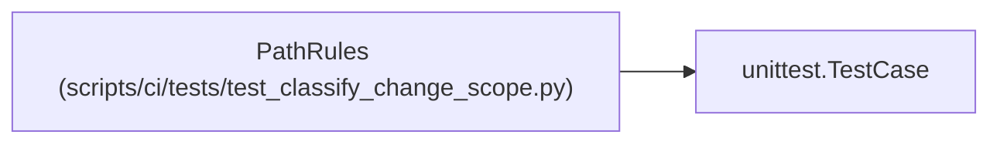

# PathRules

**Location:** `scripts/ci/tests/test_classify_change_scope.py:22`
**Kind:** Class
**Bases:** `unittest.TestCase`
**Module:** [test_classify_change_scope](../modules/test_classify_change_scope.md)

## Description

_Auto-generated from `PathRules` in `scripts/ci/tests/test_classify_change_scope.py`._

## Attributes

*No annotated attributes found.*

## Methods

| Method | Signature | Decorators | Description |
|--------|-----------|------------|-------------|
| `test_wiki_and_general_docs_are_documentation` | `()` | — | — |
| `test_documents_read_by_full_pipeline_checks_run_everything` | `()` | — | — |
| `test_closeout_inventory_documents_are_derived` | `()` | — | — |
| `test_code_and_nested_markdown_are_not_documentation` | `()` | — | — |
| `test_mixed_or_empty_changes_run_everything` | `()` | — | — |

## Relationships

<!-- Auto-generated relationship summary. Do not edit by hand. -->

### Summary

| Module | Methods | Attributes |
|---|---:|---|
| [test_classify_change_scope](../modules/test_classify_change_scope.md) | 5 | — |

### Structure

| Kind | Entity | Module |
|---|---|---|
| Base | `unittest.TestCase` | — |
