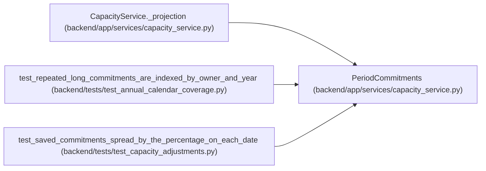

# PeriodCommitments

**Location:** `backend/app/services/capacity_service.py:52`
**Kind:** Class
**Bases:** —
**Module:** [capacity_service](../modules/capacity_service.md)

## Description

Fold baseline rates at interval boundaries without expanding each task into daily rows.

Each saved baseline contributes a rate between its first and last covered report dates. Multiple overlapping baselines share the same annual totals. During a sequential daily projection, unknown effort and uncovered annual rules remain visible independently of the sum of known hours.

## Attributes

*No annotated attributes found.*

## Methods

| Method | Signature | Decorators | Description |
|--------|-----------|------------|-------------|
| `__init__` | `(tasks, members, coverages, start, end, dated = None)` | — | — |
| `for_day` | `(day)` | — | — |

## Relationships

<!-- Auto-generated relationship summary. Do not edit by hand. -->

### Summary

| Module | Methods | Attributes |
|---|---:|---|
| [capacity_service](../modules/capacity_service.md) | 2 | — |

### References

| Reference | Kind | Source | Call sites |
|---|---|---|---:|
| `CapacityService._projection` | call | [capacity_service](../modules/capacity_service.md) | 1 |
| `test_repeated_long_commitments_are_indexed_by_owner_and_year` | call | [test_annual_calendar_coverage](../modules/test_annual_calendar_coverage.md) | 1 |
| `test_saved_commitments_spread_by_the_percentage_on_each_date` | call | [test_capacity_adjustments](../modules/test_capacity_adjustments.md) | 3 |
