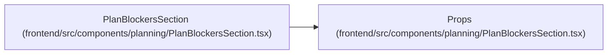

# Props

**Location:** `frontend/src/components/planning/PlanBlockersSection.tsx:20`
**Kind:** Interface
**Bases:** —
**Module:** [PlanBlockersSection](../modules/PlanBlockersSection.md)

## Description

_Auto-generated from `Props` in `frontend/src/components/planning/PlanBlockersSection.tsx`._

## Attributes

| Name | Type | Required | Default | Description |
|------|------|----------|---------|-------------|
| `iterationId` | `number` | Yes | — | — |
| `tasks` | `Task[]` | Yes | — | — |
| `members` | `TeamMember[]` | Yes | — | — |
| `unassignedCount` | `number` | Yes | — | — |
| `effortCount` | `number` | Yes | — | — |

## Methods

*No declared methods.*

## Relationships

<!-- Auto-generated relationship summary. Do not edit by hand. -->

### Summary

| Module | Methods | Attributes |
|---|---:|---|
| [PlanBlockersSection](../modules/PlanBlockersSection.md) | 0 | `effortCount`, `iterationId`, `members`, `tasks`, `unassignedCount` |

### References

| Reference | Kind | Source | Call sites |
|---|---|---|---:|
| `PlanBlockersSection` | type_reference | [PlanBlockersSection](../modules/PlanBlockersSection.md) | — |
