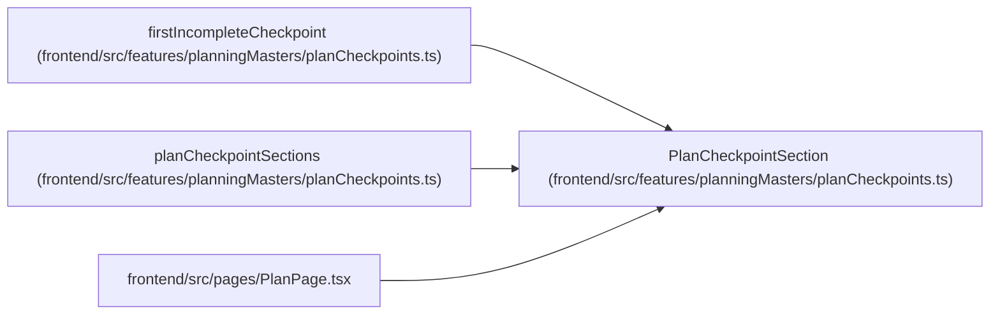

# PlanCheckpointSection

**Location:** `frontend/src/features/planningMasters/planCheckpoints.ts:8`
**Kind:** Interface
**Bases:** —
**Module:** [planCheckpoints](../modules/planCheckpoints.md)

## Description

One plan section as the page shows it, read from the server's planning-readiness response.

## Attributes

| Name | Type | Required | Default | Description |
|------|------|----------|---------|-------------|
| `id` | `PlanningStepId` | Yes | — | — |
| `number` | `number` | Yes | — | — |
| `state` | `PlanCheckpointState` | Yes | — | — |
| `waitsFor` | `PlanningStepId` | No | — | — |
| `reasonCodes` | `string[]` | Yes | — | — |
| `counts` | `Record<string, number>` | Yes | — | — |

## Methods

*No declared methods.*

## Relationships

<!-- Auto-generated relationship summary. Do not edit by hand. -->

### Summary

| Module | Methods | Attributes |
|---|---:|---|
| [planCheckpoints](../modules/planCheckpoints.md) | 0 | `counts`, `id`, `number`, `reasonCodes`, `state`, `waitsFor` |

### References

| Reference | Kind | Source | Call sites |
|---|---|---|---:|
| `firstIncompleteCheckpoint` | type_reference | [planCheckpoints](../modules/planCheckpoints.md) | — |
| `planCheckpointSections` | type_reference | [planCheckpoints](../modules/planCheckpoints.md) | — |
| `PlanPage` | import | [PlanPage](../modules/PlanPage.md) | — |
