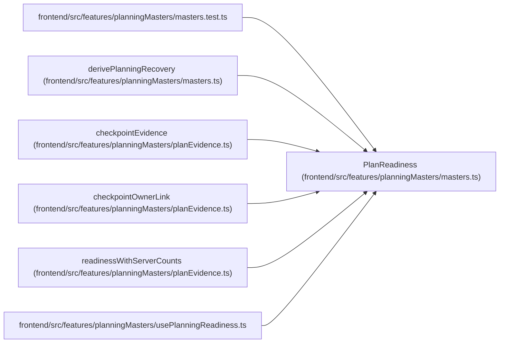

# PlanReadiness

**Location:** `frontend/src/features/planningMasters/masters.ts:8`
**Kind:** Interface
**Bases:** —
**Module:** [planningMasters_masters](../modules/planningMasters_masters.md)

## Description

_Auto-generated from `PlanReadiness` in `frontend/src/features/planningMasters/masters.ts`._

## Attributes

| Name | Type | Required | Default | Description |
|------|------|----------|---------|-------------|
| `iterationCount` | `number` | Yes | — | — |
| `hasCurrentIteration` | `boolean` | Yes | — | — |
| `currentIterationName` | `string` | Yes | — | — |
| `currentIterationStart` | `string` | Yes | — | — |
| `currentIterationEnd` | `string` | Yes | — | — |
| `currentIterationDays` | `number` | Yes | — | — |
| `teamMemberCount` | `number` | Yes | — | — |
| `teamCapacity` | `number` | Yes | — | — |
| `teamMembersNoCap` | `number` | Yes | — | — |
| `taskCount` | `number` | Yes | — | — |
| `tasksWithoutAssignee` | `number` | Yes | — | — |
| `tasksWithoutEffort` | `number` | Yes | — | — |
| `tasksAgentWithoutCapacity` | `number` | No | — | — |
| `teamAgentCount` | `number` | No | — | — |
| `hasGanttSchedule` | `boolean` | Yes | — | — |
| `ganttLastBuilt` | `string` | Yes | — | — |
| `riskCount` | `number` | Yes | — | — |
| `inboxCount` | `number` | Yes | — | — |

## Methods

*No declared methods.*

## Relationships

<!-- Auto-generated relationship summary. Do not edit by hand. -->

### Summary

| Module | Methods | Attributes |
|---|---:|---|
| [planningMasters_masters](../modules/planningMasters_masters.md) | 0 | `currentIterationDays`, `currentIterationEnd`, `currentIterationName`, `currentIterationStart`, `ganttLastBuilt`, `hasCurrentIteration`, `hasGanttSchedule`, `inboxCount`, `iterationCount`, `riskCount`, `taskCount`, `tasksAgentWithoutCapacity` |

### References

| Reference | Kind | Source | Call sites |
|---|---|---|---:|
| `masters.test` | import | [planningMasters_masters.test](../modules/planningMasters_masters.test.md) | — |
| `derivePlanningRecovery` | type_reference | [planningMasters_masters](../modules/planningMasters_masters.md) | — |
| `checkpointEvidence` | type_reference | [planEvidence](../modules/planEvidence.md) | — |
| `checkpointOwnerLink` | type_reference | [planEvidence](../modules/planEvidence.md) | — |
| `readinessWithServerCounts` | type_reference | [planEvidence](../modules/planEvidence.md) | — |
| `usePlanningReadiness` | import | [usePlanningReadiness](../modules/usePlanningReadiness.md) | — |
