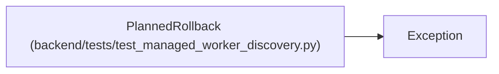

# PlannedRollback

**Location:** `backend/tests/test_managed_worker_discovery.py:204`
**Kind:** Class
**Bases:** `Exception`
**Module:** [test_managed_worker_discovery](../modules/test_managed_worker_discovery.md)

## Description

Sentinel exception that a test raises inside a command transaction to force a rollback, so it can check that the claim-bound discovery marker and the reported triage item end with the command.

## Attributes

*No annotated attributes found.*

## Methods

*No declared methods.*

## Relationships

<!-- Auto-generated relationship summary. Do not edit by hand. -->

### Summary

| Module | Methods | Attributes |
|---|---:|---|
| [test_managed_worker_discovery](../modules/test_managed_worker_discovery.md) | 0 | — |

### Structure

| Kind | Entity | Module |
|---|---|---|
| Base | `Exception` | — |
