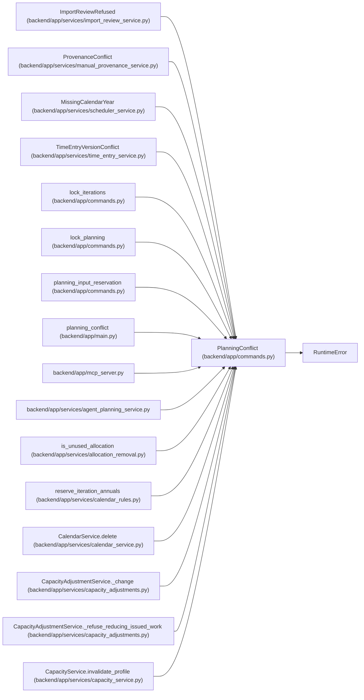

# PlanningConflict

**Location:** `backend/app/commands.py:54`
**Kind:** Class
**Bases:** `RuntimeError`
**Module:** [commands](../modules/commands.md)

## Description

_Auto-generated from `PlanningConflict` in `backend/app/commands.py`._

## Attributes

*No annotated attributes found.*

## Methods

| Method | Signature | Decorators | Description |
|--------|-----------|------------|-------------|
| `__init__` | `(code, message)` | — | — |
| `detail` | `()` | — | — |

## Relationships

<!-- Auto-generated relationship summary. Do not edit by hand. -->

### Summary

| Module | Methods | Attributes |
|---|---:|---|
| [commands](../modules/commands.md) | 2 | — |

### Structure

| Kind | Entity | Module |
|---|---|---|
| Base | `RuntimeError` | — |
| Subclass | `ImportReviewRefused` | [import_review_service](../modules/import_review_service.md) |
| Subclass | `ProvenanceConflict` | [manual_provenance_service](../modules/manual_provenance_service.md) |
| Subclass | `MissingCalendarYear` | [scheduler_service](../modules/scheduler_service.md) |
| Subclass | `TimeEntryVersionConflict` | [time_entry_service](../modules/time_entry_service.md) |

### References

| Reference | Kind | Source | Call sites |
|---|---|---|---:|
| `lock_iterations` | call | [commands](../modules/commands.md) | 1 |
| `lock_planning` | call | [commands](../modules/commands.md) | 1 |
| `planning_input_reservation` | call | [commands](../modules/commands.md) | 4 |
| `planning_conflict` | type_reference | [app_main](../modules/app_main.md) | — |
| `mcp_server` | import | [mcp_server](../modules/mcp_server.md) | — |
| `agent_planning_service` | import | [agent_planning_service](../modules/agent_planning_service.md) | — |
| `is_unused_allocation` | call | [allocation_removal](../modules/allocation_removal.md) | 1 |
| `reserve_iteration_annuals` | call | [calendar_rules](../modules/calendar_rules.md) | 2 |
| `CalendarService.delete` | call | [calendar_service](../modules/calendar_service.md) | 2 |
| `CapacityAdjustmentService._change` | call | [capacity_adjustments](../modules/capacity_adjustments.md) | 7 |
| `CapacityAdjustmentService._refuse_reducing_issued_work` | call | [capacity_adjustments](../modules/capacity_adjustments.md) | 1 |
| `CapacityService.invalidate_profile` | call | [capacity_service](../modules/capacity_service.md) | 2 |

> References: showing 12 of 93 logical references; 81 omitted by the 12-row generated summary limit.
