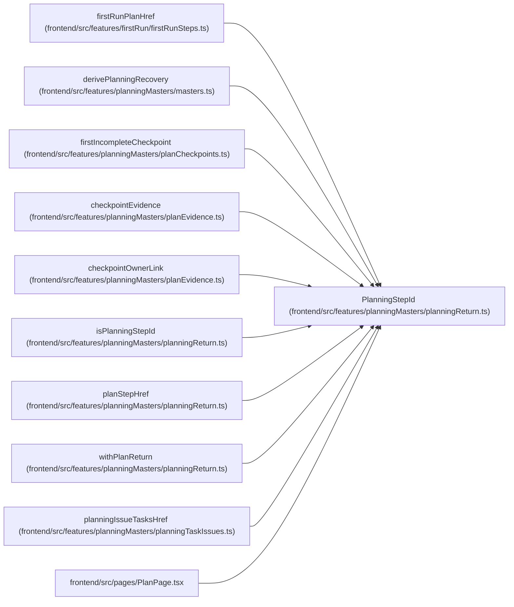

# PlanningStepId

**Location:** `frontend/src/features/planningMasters/planningReturn.ts:12`
**Kind:** Type alias
**Bases:** —
**Module:** [planningReturn](../modules/planningReturn.md)
**Target:**

```typescript
typeof PLANNING_STEP_IDS[number]
```

## Description

_Auto-generated from `PlanningStepId` in `frontend/src/features/planningMasters/planningReturn.ts`._

## Attributes

*See the alias definition for its member types.*

## Methods

*See the alias definition for callable and member types.*

## Relationships

<!-- Auto-generated relationship summary. Do not edit by hand. -->


### Summary

| Module | Methods | Attributes |
|---|---:|---|
| [planningReturn](../modules/planningReturn.md) | 0 | — |

### References

| Reference | Kind | Source | Call sites |
|---|---|---|---:|
| `firstRunPlanHref` | type_reference | [firstRunSteps](../modules/firstRunSteps.md) | — |
| `derivePlanningRecovery` | type_reference | [planningMasters_masters](../modules/planningMasters_masters.md) | — |
| `firstIncompleteCheckpoint` | type_reference | [planCheckpoints](../modules/planCheckpoints.md) | — |
| `checkpointEvidence` | type_reference | [planEvidence](../modules/planEvidence.md) | — |
| `checkpointOwnerLink` | type_reference | [planEvidence](../modules/planEvidence.md) | — |
| `isPlanningStepId` | type_reference | [planningReturn](../modules/planningReturn.md) | — |
| `planStepHref` | type_reference | [planningReturn](../modules/planningReturn.md) | — |
| `withPlanReturn` | type_reference | [planningReturn](../modules/planningReturn.md) | — |
| `planningIssueTasksHref` | type_reference | [planningTaskIssues](../modules/planningTaskIssues.md) | — |
| `PlanPage` | import | [PlanPage](../modules/PlanPage.md) | — |
