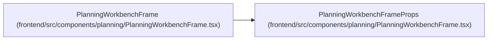

# PlanningWorkbenchFrameProps

**Location:** `frontend/src/components/planning/PlanningWorkbenchFrame.tsx:12`
**Kind:** Type alias
**Bases:** —
**Module:** [PlanningWorkbenchFrame](../modules/PlanningWorkbenchFrame.md)
**Target:**

```typescript
{
    title: ReactNode;
    description?: ReactNode;
    facts?: PlanningWorkbenchFact[];
    contextControl?: ReactNode;
    secondaryActions?: ReactNode;
    primaryAction?: ReactNode;
    overflowAction?: ReactNode;
    state?: ReactNode;
    children: ReactNode;
    variant?: 'default' | 'wide' | 'workbench';
    className?: string;
    headerClassName?: string;
    canvasClassName?: string;
    testId?: string;
}
```

## Description

_Auto-generated from `PlanningWorkbenchFrameProps` in `frontend/src/components/planning/PlanningWorkbenchFrame.tsx`._

## Attributes

*See the alias definition for its member types.*

## Methods

*See the alias definition for callable and member types.*

## Relationships

<!-- Auto-generated relationship summary. Do not edit by hand. -->


### Summary

| Module | Methods | Attributes |
|---|---:|---|
| [PlanningWorkbenchFrame](../modules/PlanningWorkbenchFrame.md) | 0 | — |

### References

| Reference | Kind | Source | Call sites |
|---|---|---|---:|
| `PlanningWorkbenchFrame` | type_reference | [PlanningWorkbenchFrame](../modules/PlanningWorkbenchFrame.md) | — |
