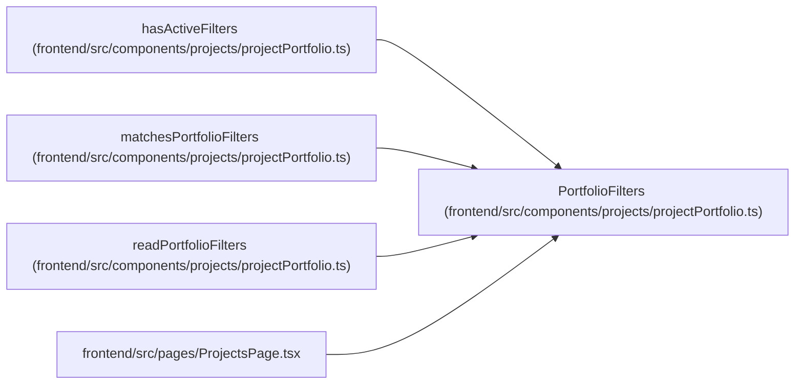

# PortfolioFilters

**Location:** `frontend/src/components/projects/projectPortfolio.ts:11`
**Kind:** Type alias
**Bases:** —
**Module:** [projectPortfolio](../modules/projectPortfolio.md)
**Target:**

```typescript
{
    search: string;
    status: ProjectStatus | '';
    health: ProjectHealth | '';
    /** `profile:<id>`, `member:<id>` or `none`. */
    owner: string;
    /** An initiative id or `none`. */
    initiative: string;
    /**
     * Set by the at-risk count: at risk or off track. The Health filter shows it
     * as its "At risk or off track" option, so it is never set together with `health`.
     */
    attention: 'at_risk' | '';
}
```

## Description

Everything that narrows the portfolio, as it is kept in the address bar.
Both views read the same values, so switching views keeps them.

## Attributes

*See the alias definition for its member types.*

## Methods

*See the alias definition for callable and member types.*

## Relationships

<!-- Auto-generated relationship summary. Do not edit by hand. -->


### Summary

| Module | Methods | Attributes |
|---|---:|---|
| [projectPortfolio](../modules/projectPortfolio.md) | 0 | — |

### References

| Reference | Kind | Source | Call sites |
|---|---|---|---:|
| `hasActiveFilters` | type_reference | [projectPortfolio](../modules/projectPortfolio.md) | — |
| `matchesPortfolioFilters` | type_reference | [projectPortfolio](../modules/projectPortfolio.md) | — |
| `readPortfolioFilters` | type_reference | [projectPortfolio](../modules/projectPortfolio.md) | — |
| `ProjectsPage` | import | [ProjectsPage](../modules/ProjectsPage.md) | — |
