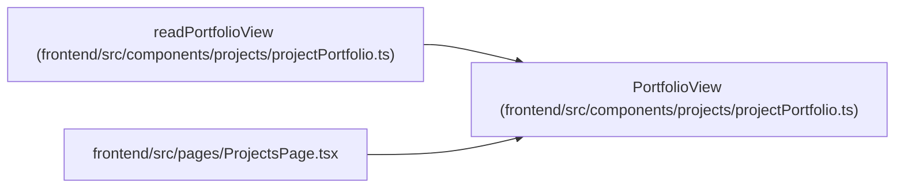

# PortfolioView

**Location:** `frontend/src/components/projects/projectPortfolio.ts:5`
**Kind:** Type alias
**Bases:** —
**Module:** [projectPortfolio](../modules/projectPortfolio.md)
**Target:**

```typescript
'list' | 'roadmap'
```

## Description

The two views of the portfolio.

## Attributes

*See the alias definition for its member types.*

## Methods

*See the alias definition for callable and member types.*

## Relationships

<!-- Auto-generated relationship summary. Do not edit by hand. -->


### Summary

| Module | Methods | Attributes |
|---|---:|---|
| [projectPortfolio](../modules/projectPortfolio.md) | 0 | — |

### References

| Reference | Kind | Source | Call sites |
|---|---|---|---:|
| `readPortfolioView` | type_reference | [projectPortfolio](../modules/projectPortfolio.md) | — |
| `ProjectsPage` | import | [ProjectsPage](../modules/ProjectsPage.md) | — |
