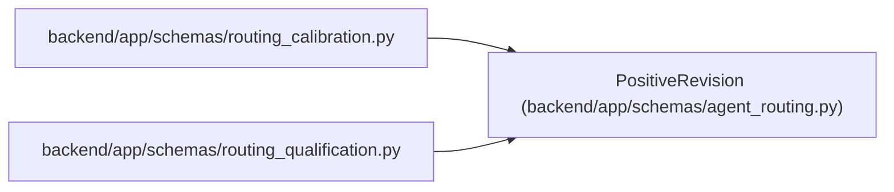

# PositiveRevision

**Location:** `backend/app/schemas/agent_routing.py:72`
**Kind:** Type alias
**Bases:** —
**Module:** [agent_routing](../modules/agent_routing.md)
**Target:** `Annotated[int, Field(strict=True, ge=1)]`

## Description

_Auto-generated from `PositiveRevision` in `backend/app/schemas/agent_routing.py`._

## Attributes

*See the alias definition for its member types.*

## Methods

*See the alias definition for callable and member types.*

## Relationships

<!-- Auto-generated relationship summary. Do not edit by hand. -->

### Summary

| Module | Methods | Attributes |
|---|---:|---|
| [agent_routing](../modules/agent_routing.md) | 0 | — |

### References

| Reference | Kind | Source | Call sites |
|---|---|---|---:|
| `routing_calibration` | import | [schemas_routing_calibration](../modules/schemas_routing_calibration.md) | — |
| `routing_qualification` | import | [schemas_routing_qualification](../modules/schemas_routing_qualification.md) | — |
