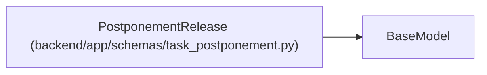

# PostponementRelease

**Location:** `backend/app/schemas/task_postponement.py:108`
**Kind:** Pydantic model
**Bases:** `BaseModel`
**Module:** [schemas_task_postponement](../modules/schemas_task_postponement.md)

## Description

Execution ownership the postponement ended through the fenced release.

## Attributes

| Name | Type | Wire name | Required | Nullable | Default | Constraints | Examples | Description |
|------|------|-----------|----------|----------|---------|-------------|-------------|----------|
| `claim_actor_id` | `int \| None` | `claim_actor_id` | No | Yes | `None` | — | — | — |
| `claim_generation` | `int \| None` | `claim_generation` | No | Yes | `None` | — | — | — |
| `assignment_ids` | `list[int]` | `assignment_ids` | No | No | factory: `list` | — | — | — |
| `run_ids` | `list[int]` | `run_ids` | No | No | factory: `list` | — | — | — |

## Methods

*No declared methods.*

## Relationships

<!-- Auto-generated relationship summary. Do not edit by hand. -->

### Summary

| Module | Methods | Attributes |
|---|---:|---|
| [schemas_task_postponement](../modules/schemas_task_postponement.md) | 0 | `assignment_ids`, `claim_actor_id`, `claim_generation`, `run_ids` |

### Structure

| Kind | Entity | Module |
|---|---|---|
| Base | `BaseModel` | — |
