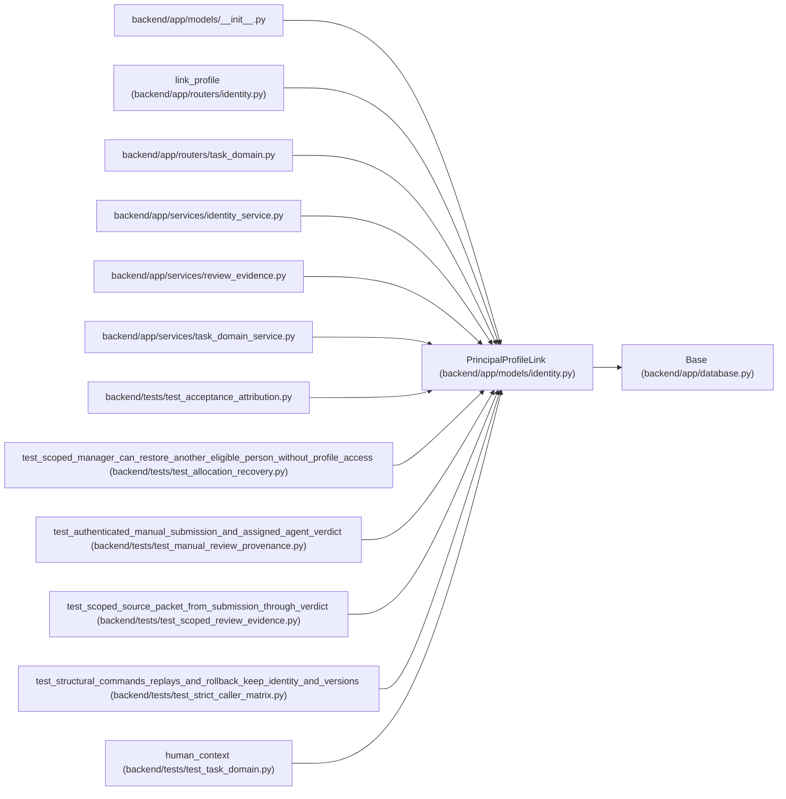

# PrincipalProfileLink

**Location:** `backend/app/models/identity.py:58`
**Kind:** Class
**Bases:** `Base`
**Module:** [models_identity](../modules/models_identity.md)

## Description

_Auto-generated from `PrincipalProfileLink` in `backend/app/models/identity.py`._

## Attributes

| Name | Type | Default | Description |
|------|------|---------|-------------|
| `principal_id` | `Mapped[int]` | `mapped_column(ForeignKey('principals.id', ondelete='CASCADE'), primary_key=True)` | — |
| `profile_id` | `Mapped[int]` | `mapped_column(ForeignKey('team_member_profiles.id', ondelete='RESTRICT'), unique=True)` | — |
| `linked_by_principal_id` | `Mapped[int]` | `mapped_column(ForeignKey('principals.id', ondelete='RESTRICT'))` | — |
| `created_at` | `Mapped[datetime]` | `mapped_column(UTCDateTime(), default=utc_now)` | — |

## Methods

*No declared methods.*

## Relationships

<!-- Auto-generated relationship summary. Do not edit by hand. -->

### Summary

| Module | Methods | Attributes |
|---|---:|---|
| [models_identity](../modules/models_identity.md) | 0 | `created_at`, `linked_by_principal_id`, `principal_id`, `profile_id` |

### Structure

| Kind | Entity | Module |
|---|---|---|
| Base | `Base` | [app_database](../modules/app_database.md) |

### References

| Reference | Kind | Source | Call sites |
|---|---|---|---:|
| `__init__` | import | [models___init__](../modules/models___init__.md) | — |
| `link_profile` | call | [routers_identity](../modules/routers_identity.md) | 1 |
| `task_domain` | import | [routers_task_domain](../modules/routers_task_domain.md) | — |
| `identity_service` | import | [identity_service](../modules/identity_service.md) | — |
| `review_evidence` | import | [services_review_evidence](../modules/services_review_evidence.md) | — |
| `task_domain_service` | import | [task_domain_service](../modules/task_domain_service.md) | — |
| `test_acceptance_attribution` | import | [test_acceptance_attribution](../modules/test_acceptance_attribution.md) | — |
| `test_scoped_manager_can_restore_another_eligible_person_without_profile_access` | call | [test_allocation_recovery](../modules/test_allocation_recovery.md) | 1 |
| `test_authenticated_manual_submission_and_assigned_agent_verdict` | call | [test_manual_review_provenance](../modules/test_manual_review_provenance.md) | 1 |
| `test_scoped_source_packet_from_submission_through_verdict` | call | [test_scoped_review_evidence](../modules/test_scoped_review_evidence.md) | 1 |
| `test_structural_commands_replays_and_rollback_keep_identity_and_versions` | call | [test_strict_caller_matrix](../modules/test_strict_caller_matrix.md) | 1 |
| `human_context` | call | [test_task_domain](../modules/test_task_domain.md) | 1 |

> References: showing 12 of 13 logical references; 1 omitted by the 12-row generated summary limit.
