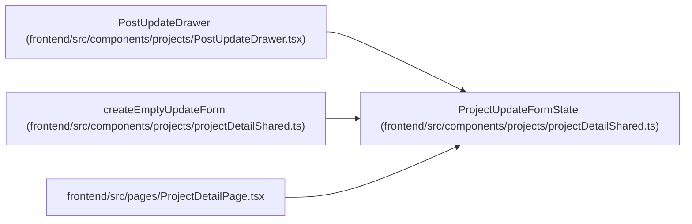

# ProjectUpdateFormState

**Location:** `frontend/src/components/projects/projectDetailShared.ts:92`
**Kind:** Type alias
**Bases:** —
**Module:** [projectDetailShared](../modules/projectDetailShared.md)
**Target:**

```typescript
{
    health: ProjectHealth;
    summary: string;
    progress_text: string;
    risks_text: string;
    decisions_text: string;
    next_steps_text: string;
}
```

## Description

_Auto-generated from `ProjectUpdateFormState` in `frontend/src/components/projects/projectDetailShared.ts`._

## Attributes

*See the alias definition for its member types.*

## Methods

*See the alias definition for callable and member types.*

## Relationships

<!-- Auto-generated relationship summary. Do not edit by hand. -->


### Summary

| Module | Methods | Attributes |
|---|---:|---|
| [projectDetailShared](../modules/projectDetailShared.md) | 0 | — |

### References

| Reference | Kind | Source | Call sites |
|---|---|---|---:|
| `PostUpdateDrawer` | type_reference | [PostUpdateDrawer](../modules/PostUpdateDrawer.md) | — |
| `createEmptyUpdateForm` | type_reference | [projectDetailShared](../modules/projectDetailShared.md) | — |
| `ProjectDetailPage` | import | [ProjectDetailPage](../modules/ProjectDetailPage.md) | — |
