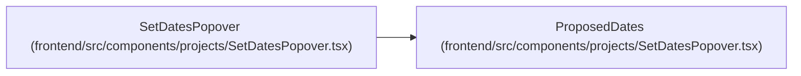

# ProposedDates

**Location:** `frontend/src/components/projects/SetDatesPopover.tsx:25`
**Kind:** Type alias
**Bases:** —
**Module:** [SetDatesPopover](../modules/SetDatesPopover.md)
**Target:**

```typescript
{ start: string; target: string }
```

## Description

Dates to start from instead of today and four weeks on, as `yyyy-MM-dd`.

## Attributes

*See the alias definition for its member types.*

## Methods

*See the alias definition for callable and member types.*

## Relationships

<!-- Auto-generated relationship summary. Do not edit by hand. -->


### Summary

| Module | Methods | Attributes |
|---|---:|---|
| [SetDatesPopover](../modules/SetDatesPopover.md) | 0 | — |

### References

| Reference | Kind | Source | Call sites |
|---|---|---|---:|
| `SetDatesPopover` | type_reference | [SetDatesPopover](../modules/SetDatesPopover.md) | — |
