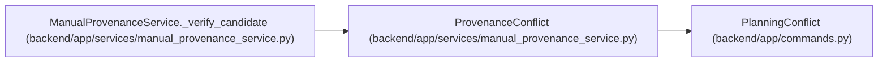

# ProvenanceConflict

**Location:** `backend/app/services/manual_provenance_service.py:45`
**Kind:** Class
**Bases:** `PlanningConflict`
**Module:** [manual_provenance_service](../modules/manual_provenance_service.md)

## Description

A refusal that also names the offending fact, such as a commit and its attribution gap.

## Attributes

*No annotated attributes found.*

## Methods

| Method | Signature | Decorators | Description |
|--------|-----------|------------|-------------|
| `__init__` | `(code, message, **context)` | — | — |
| `detail` | `()` | — | — |

## Relationships

<!-- Auto-generated relationship summary. Do not edit by hand. -->

### Summary

| Module | Methods | Attributes |
|---|---:|---|
| [manual_provenance_service](../modules/manual_provenance_service.md) | 2 | — |

### Structure

| Kind | Entity | Module |
|---|---|---|
| Base | `PlanningConflict` | [commands](../modules/commands.md) |

### References

| Reference | Kind | Source | Call sites |
|---|---|---|---:|
| `ManualProvenanceService._verify_candidate` | call | [manual_provenance_service](../modules/manual_provenance_service.md) | 6 |
