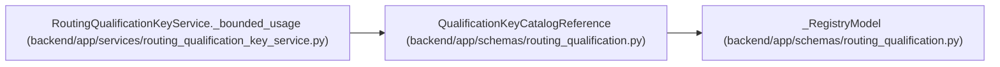

# QualificationKeyCatalogReference

**Location:** `backend/app/schemas/routing_qualification.py:124`
**Kind:** Pydantic model
**Bases:** `_RegistryModel`
**Module:** [schemas_routing_qualification](../modules/schemas_routing_qualification.md)

## Description

A catalog entry that holds the key.

## Attributes

| Name | Type | Wire name | Required | Nullable | Default | Constraints | Examples | Description |
|------|------|-----------|----------|----------|---------|-------------|-------------|----------|
| `id` | `int` | `id` | Yes | No | — | — | — | — |
| `key` | `str` | `key` | Yes | No | — | — | — | — |
| `enabled` | `bool` | `enabled` | Yes | No | — | — | — | — |

## Methods

*No declared methods.*

## Relationships

<!-- Auto-generated relationship summary. Do not edit by hand. -->

### Summary

| Module | Methods | Attributes |
|---|---:|---|
| [schemas_routing_qualification](../modules/schemas_routing_qualification.md) | 0 | `enabled`, `id`, `key` |

### Structure

| Kind | Entity | Module |
|---|---|---|
| Base | `_RegistryModel` | [schemas_routing_qualification](../modules/schemas_routing_qualification.md) |

### References

| Reference | Kind | Source | Call sites |
|---|---|---|---:|
| `RoutingQualificationKeyService._bounded_usage` | call | [routing_qualification_key_service](../modules/routing_qualification_key_service.md) | 1 |
