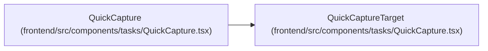

# QuickCaptureTarget

**Location:** `frontend/src/components/tasks/QuickCapture.tsx:14`
**Kind:** Type alias
**Bases:** —
**Module:** [QuickCapture](../modules/QuickCapture.md)
**Target:**

```typescript
{ kind: 'task'; iterationId: number } | { kind: 'triage' }
```

## Description

_Auto-generated from `QuickCaptureTarget` in `frontend/src/components/tasks/QuickCapture.tsx`._

## Attributes

*See the alias definition for its member types.*

## Methods

*See the alias definition for callable and member types.*

## Relationships

<!-- Auto-generated relationship summary. Do not edit by hand. -->


### Summary

| Module | Methods | Attributes |
|---|---:|---|
| [QuickCapture](../modules/QuickCapture.md) | 0 | — |

### References

| Reference | Kind | Source | Call sites |
|---|---|---|---:|
| `QuickCapture` | type_reference | [QuickCapture](../modules/QuickCapture.md) | — |
