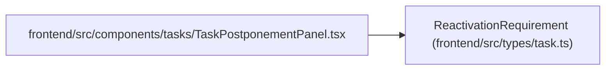

# ReactivationRequirement

**Location:** `frontend/src/types/task.ts:485`
**Kind:** Interface
**Bases:** —
**Module:** [types_task](../modules/types_task.md)

## Description

_Auto-generated from `ReactivationRequirement` in `frontend/src/types/task.ts`._

## Attributes

| Name | Type | Required | Default | Description |
|------|------|----------|---------|-------------|
| `id` | `number` | Yes | — | — |
| `position` | `number` | Yes | — | — |
| `kind` | `ReactivationRequirementKind` | Yes | — | — |
| `task_id` | `number \| null` | Yes | — | — |
| `triage_item_id` | `number \| null` | Yes | — | — |
| `on_date` | `string \| null` | Yes | — | — |
| `description` | `string \| null` | Yes | — | — |
| `met` | `boolean` | Yes | — | — |
| `met_at` | `string \| null` | Yes | — | — |

## Methods

*No declared methods.*

## Relationships

<!-- Auto-generated relationship summary. Do not edit by hand. -->

### Summary

| Module | Methods | Attributes |
|---|---:|---|
| [types_task](../modules/types_task.md) | 0 | `description`, `id`, `kind`, `met`, `met_at`, `on_date`, `position`, `task_id`, `triage_item_id` |

### References

| Reference | Kind | Source | Call sites |
|---|---|---|---:|
| `TaskPostponementPanel` | import | [TaskPostponementPanel](../modules/TaskPostponementPanel.md) | — |
