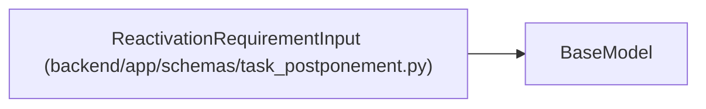

# ReactivationRequirementInput

**Location:** `backend/app/schemas/task_postponement.py:24`
**Kind:** Pydantic model
**Bases:** `BaseModel`
**Module:** [schemas_task_postponement](../modules/schemas_task_postponement.md)

## Description

One condition that must hold before postponed work resumes.

- ``predecessor_accepted``: ``task_id`` names a task that must be accepted.
- ``date``: ``on_date`` is a day after today in the task's working time zone.
- ``owner_decision``: ``description`` says what the owner must decide.
- ``linked_resolved``: ``task_id`` or ``triage_item_id`` names work that must be resolved.

## Model Configuration

| Setting | Value | Source |
|---------|-------|--------|
| `extra` | `'forbid'` | model_config |

## Validators

| Method | Scope | Fields | Mode | Options |
|--------|-------|--------|------|---------|
| `_description` | field | description | after | — |
| `_shape` | model | — | after | — |

## Attributes

| Name | Type | Wire name | Required | Nullable | Default | Constraints | Examples | Description |
|------|------|-----------|----------|----------|---------|-------------|-------------|----------|
| `kind` | `RequirementKind` | `kind` | Yes | No | — | — | — | — |
| `task_id` | `int \| None` | `task_id` | No | Yes | `None` | ge=1 | — | — |
| `triage_item_id` | `int \| None` | `triage_item_id` | No | Yes | `None` | ge=1 | — | — |
| `on_date` | `date \| None` | `on_date` | No | Yes | `None` | — | — | — |
| `description` | `str \| None` | `description` | No | Yes | `None` | max_length=2000 | — | — |

## Methods

| Method | Signature | Decorators | Description |
|--------|-----------|------------|-------------|
| `_description` | `(value: str \| None) -> str \| None` | `@field_validator('description')`, `@classmethod` | — |
| `_shape` | `()` | `@model_validator(mode='after')` | — |

## Relationships

<!-- Auto-generated relationship summary. Do not edit by hand. -->

### Summary

| Module | Methods | Attributes |
|---|---:|---|
| [schemas_task_postponement](../modules/schemas_task_postponement.md) | 2 | `description`, `kind`, `on_date`, `task_id`, `triage_item_id` |

### Structure

| Kind | Entity | Module |
|---|---|---|
| Base | `BaseModel` | — |
