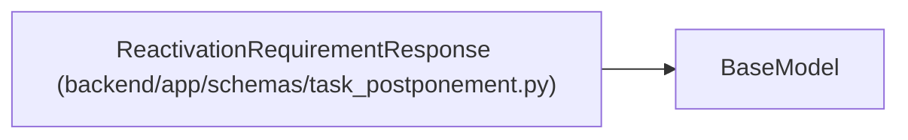

# ReactivationRequirementResponse

**Location:** `backend/app/schemas/task_postponement.py:115`
**Kind:** Pydantic model
**Bases:** `BaseModel`
**Module:** [schemas_task_postponement](../modules/schemas_task_postponement.md)

## Description

One condition a postponed task waits on, as returned to clients: its kind and target (a task, a triage item, a date or an owner decision), its position, and whether it is met and when. A met requirement stays met even if its target later changes.

## Attributes

| Name | Type | Wire name | Required | Nullable | Default | Constraints | Examples | Description |
|------|------|-----------|----------|----------|---------|-------------|-------------|----------|
| `id` | `int` | `id` | Yes | No | — | — | — | — |
| `position` | `int` | `position` | Yes | No | — | — | — | — |
| `kind` | `RequirementKind` | `kind` | Yes | No | — | — | — | — |
| `task_id` | `int \| None` | `task_id` | No | Yes | `None` | — | — | The task this requirement names; null if it was deleted. |
| `triage_item_id` | `int \| None` | `triage_item_id` | No | Yes | `None` | — | — | The triage item this requirement names; null if it was deleted. |
| `on_date` | `date \| None` | `on_date` | No | Yes | `None` | — | — | — |
| `description` | `str \| None` | `description` | No | Yes | `None` | — | — | — |
| `met` | `bool` | `met` | Yes | No | — | — | — | Whether the requirement is met. A met requirement stays met. |
| `met_at` | `datetime \| None` | `met_at` | No | Yes | `None` | — | — | When the requirement was evaluated as met; null while unmet. |

## Methods

*No declared methods.*

## Relationships

<!-- Auto-generated relationship summary. Do not edit by hand. -->

### Summary

| Module | Methods | Attributes |
|---|---:|---|
| [schemas_task_postponement](../modules/schemas_task_postponement.md) | 0 | `description`, `id`, `kind`, `met`, `met_at`, `on_date`, `position`, `task_id`, `triage_item_id` |

### Structure

| Kind | Entity | Module |
|---|---|---|
| Base | `BaseModel` | — |
