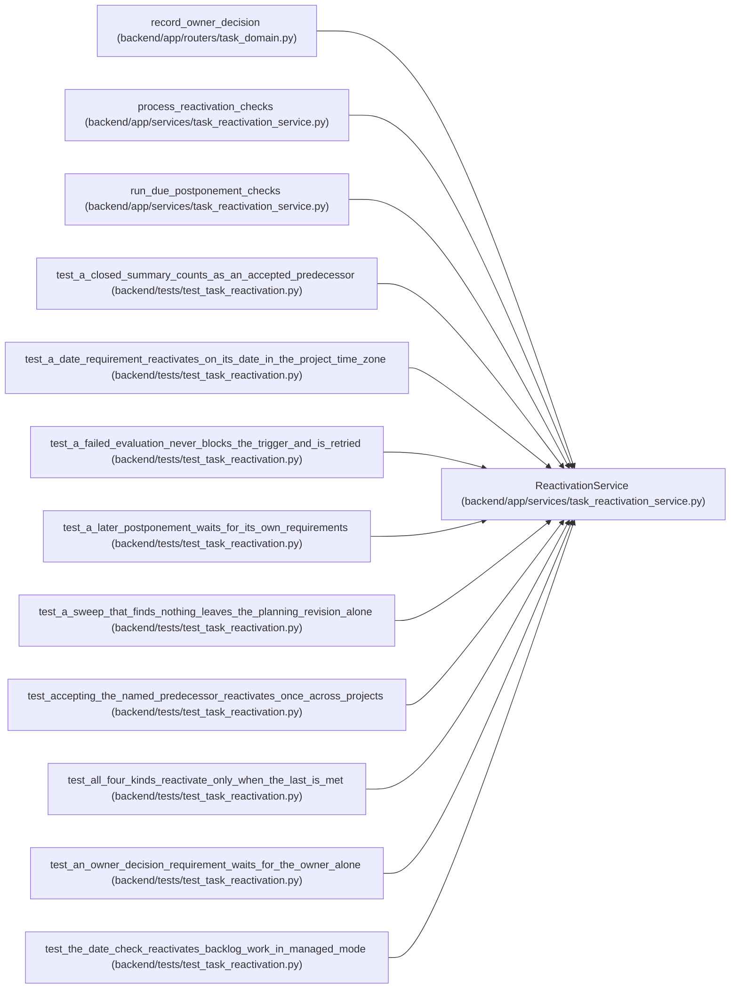

# ReactivationService

**Location:** `backend/app/services/task_reactivation_service.py:104`
**Kind:** Class
**Bases:** —
**Module:** [task_reactivation_service](../modules/task_reactivation_service.md)

## Description

Returns postponed work to its lifecycle once every recorded requirement holds. Requirements are evaluated whenever the facts they depend on can change: a task is resolved or accepted, a triage item is resolved, the owner records a decision, and on the periodic date check that also finishes any evaluation that could not complete earlier. Each evaluation takes the shared planning lock before the postponement row, so concurrent triggers serialize and the task is reactivated exactly once. Owner decisions are never inferred; only the workspace owner records them.

## Attributes

*No annotated attributes found.*

## Methods

| Method | Signature | Decorators | Description |
|--------|-----------|------------|-------------|
| `__init__` | `(db)` | — | — |
| `evaluate_waiting` | *(async)* `(task_ids, triage_item_ids)` | — | Evaluate each open postponement with an unmet requirement on this work. |
| `run_date_check` | *(async)* `(*, now = None)` | — | The periodic check: reactivate postponed work whose requirements now hold, notably its date. |
| `evaluate_one` | *(async)* `(postponement_id, *, now = None, commit = True)` | `@atomic_command` | Evaluate one open postponement as its own command; the task ID if it was reactivated. |
| `record_owner_decision` | *(async)* `(task_id, requirement_id, data, *, commit = True)` | `@atomic_command` | The owner's command: record that the decision an owner_decision requirement waits for was made. |
| `_latest` | *(async)* `(task_id)` | — | — |
| `_requirements` | *(async)* `(postponement)` | — | — |
| `_save_state` | `()` | — | Copy the command's reservations so a failed evaluation can give back what it took. |
| `_restore_state` | `(saved)` | — | — |
| `_evaluate_isolated` | *(async)* `(postponement_id, *, now = None)` | — | Evaluate one postponement in a savepoint: a failure never blocks the command that triggered it. |
| `_due` | *(async)* `(postponement_id, now = None)` | — | Read-only: whether a requirement of this open postponement newly holds, or all are already met. |
| `_evaluate` | *(async)* `(postponement_id, *, now = None)` | — | Mark each requirement that now holds as met and reactivate once every one is met. |
| `_apply` | *(async)* `(postponement, task, requirements, now, newly_met)` | — | Record every requirement that holds now, then reactivate if all are met. |
| `_holding` | *(async)* `(requirements, task, now)` | — | The unmet requirements whose fact is true now. An owner decision is never inferred. |
| `_holds` | *(async)* `(requirement, today)` | — | — |
| `_complete_if_met` | *(async)* `(postponement, task, newly_met, requirements)` | — | Reactivate the task once, if every requirement is met; return its ID, or None. |
| `_notify_pm` | *(async)* `(task, postponement, newly_met, reason)` | — | Tell the project's planning side the work is back: a durable event for webhooks and agents. |

## Relationships

<!-- Auto-generated relationship summary. Do not edit by hand. -->

### Summary

| Module | Methods | Attributes |
|---|---:|---|
| [task_reactivation_service](../modules/task_reactivation_service.md) | 17 | — |

### References

| Reference | Kind | Source | Call sites |
|---|---|---|---:|
| `record_owner_decision` | call | [routers_task_domain](../modules/routers_task_domain.md) | 1 |
| `process_reactivation_checks` | call | [task_reactivation_service](../modules/task_reactivation_service.md) | 1 |
| `run_due_postponement_checks` | call | [task_reactivation_service](../modules/task_reactivation_service.md) | 1 |
| `test_a_closed_summary_counts_as_an_accepted_predecessor` | call | [test_task_reactivation](../modules/test_task_reactivation.md) | 2 |
| `test_a_date_requirement_reactivates_on_its_date_in_the_project_time_zone` | call | [test_task_reactivation](../modules/test_task_reactivation.md) | 5 |
| `test_a_failed_evaluation_never_blocks_the_trigger_and_is_retried` | call | [test_task_reactivation](../modules/test_task_reactivation.md) | 1 |
| `test_a_later_postponement_waits_for_its_own_requirements` | call | [test_task_reactivation](../modules/test_task_reactivation.md) | 1 |
| `test_a_sweep_that_finds_nothing_leaves_the_planning_revision_alone` | call | [test_task_reactivation](../modules/test_task_reactivation.md) | 1 |
| `test_accepting_the_named_predecessor_reactivates_once_across_projects` | call | [test_task_reactivation](../modules/test_task_reactivation.md) | 1 |
| `test_all_four_kinds_reactivate_only_when_the_last_is_met` | call | [test_task_reactivation](../modules/test_task_reactivation.md) | 2 |
| `test_an_owner_decision_requirement_waits_for_the_owner_alone` | call | [test_task_reactivation](../modules/test_task_reactivation.md) | 6 |
| `test_the_date_check_reactivates_backlog_work_in_managed_mode` | call | [test_task_reactivation](../modules/test_task_reactivation.md) | 1 |

> References: showing 12 of 14 logical references; 2 omitted by the 12-row generated summary limit.
