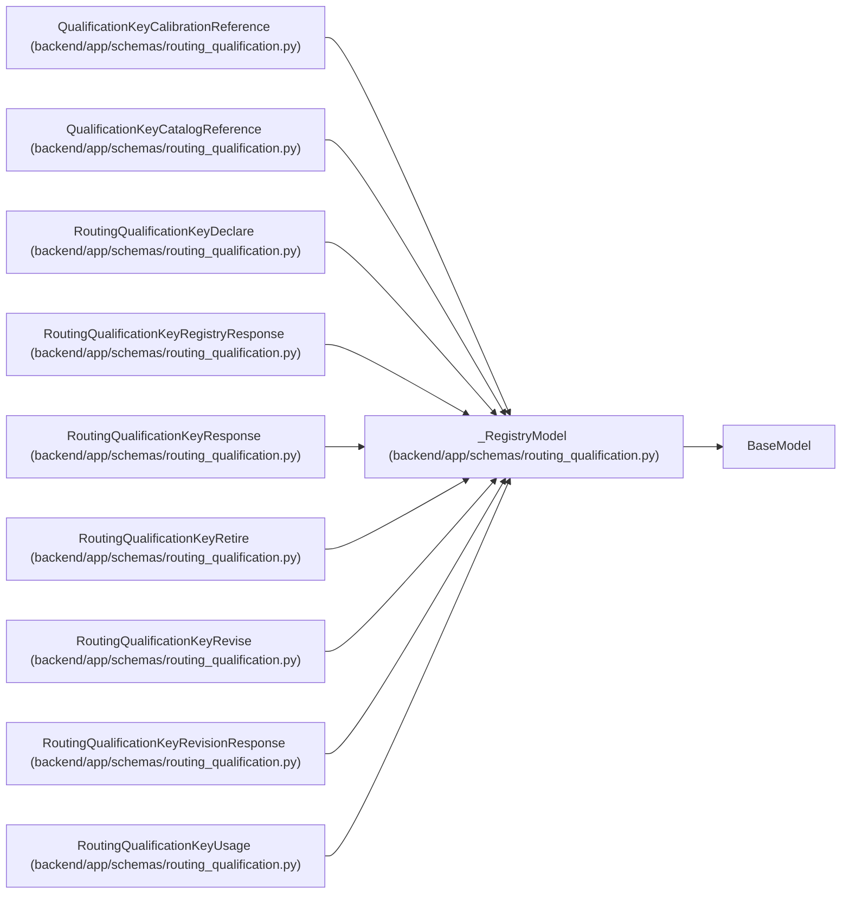

# _RegistryModel

**Location:** `backend/app/schemas/routing_qualification.py:25`
**Kind:** Pydantic model
**Bases:** `BaseModel`
**Module:** [schemas_routing_qualification](../modules/schemas_routing_qualification.md)

## Description

Shared base for the qualification key registry schemas. It forbids unknown fields and reads from ORM rows.

## Model Configuration

| Setting | Value | Source |
|---------|-------|--------|
| `extra` | `'forbid'` | model_config |
| `from_attributes` | `True` | model_config |

## Attributes

*No annotated attributes found.*

## Methods

*No declared methods.*

## Relationships

<!-- Auto-generated relationship summary. Do not edit by hand. -->

### Summary

| Module | Methods | Attributes |
|---|---:|---|
| [schemas_routing_qualification](../modules/schemas_routing_qualification.md) | 0 | — |

### Structure

| Kind | Entity | Module |
|---|---|---|
| Base | `BaseModel` | — |
| Subclass | `QualificationKeyCalibrationReference` | [schemas_routing_qualification](../modules/schemas_routing_qualification.md) |
| Subclass | `QualificationKeyCatalogReference` | [schemas_routing_qualification](../modules/schemas_routing_qualification.md) |
| Subclass | `RoutingQualificationKeyDeclare` | [schemas_routing_qualification](../modules/schemas_routing_qualification.md) |
| Subclass | `RoutingQualificationKeyRegistryResponse` | [schemas_routing_qualification](../modules/schemas_routing_qualification.md) |
| Subclass | `RoutingQualificationKeyResponse` | [schemas_routing_qualification](../modules/schemas_routing_qualification.md) |
| Subclass | `RoutingQualificationKeyRetire` | [schemas_routing_qualification](../modules/schemas_routing_qualification.md) |
| Subclass | `RoutingQualificationKeyRevise` | [schemas_routing_qualification](../modules/schemas_routing_qualification.md) |
| Subclass | `RoutingQualificationKeyRevisionResponse` | [schemas_routing_qualification](../modules/schemas_routing_qualification.md) |
| Subclass | `RoutingQualificationKeyUsage` | [schemas_routing_qualification](../modules/schemas_routing_qualification.md) |
