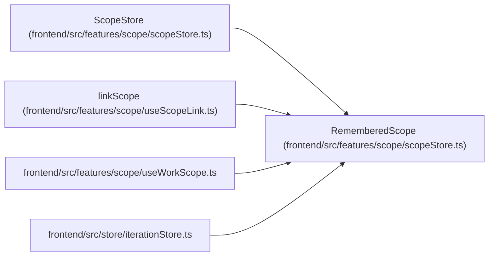

# RememberedScope

**Location:** `frontend/src/features/scope/scopeStore.ts:10`
**Kind:** Interface
**Bases:** —
**Module:** [scopeStore](../modules/scopeStore.md)

## Description

_Auto-generated from `RememberedScope` in `frontend/src/features/scope/scopeStore.ts`._

## Attributes

| Name | Type | Required | Default | Description |
|------|------|----------|---------|-------------|
| `project` | `ScopeProject \| null` | Yes | — | — |
| `iteration` | `ScopeIteration \| null` | Yes | — | — |

## Methods

*No declared methods.*

## Relationships

<!-- Auto-generated relationship summary. Do not edit by hand. -->

### Summary

| Module | Methods | Attributes |
|---|---:|---|
| [scopeStore](../modules/scopeStore.md) | 0 | `iteration`, `project` |

### Structure

| Kind | Entity | Module |
|---|---|---|
| Subclass | `ScopeStore` | [scopeStore](../modules/scopeStore.md) |

### References

| Reference | Kind | Source | Call sites |
|---|---|---|---:|
| `linkScope` | type_reference | [useScopeLink](../modules/useScopeLink.md) | — |
| `useWorkScope` | import | [useWorkScope](../modules/useWorkScope.md) | — |
| `iterationStore` | import | [iterationStore](../modules/iterationStore.md) | — |
