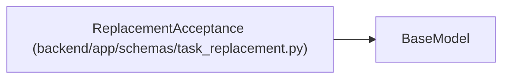

# ReplacementAcceptance

**Location:** `backend/app/schemas/task_replacement.py:100`
**Kind:** Pydantic model
**Bases:** `BaseModel`
**Module:** [schemas_task_replacement](../modules/schemas_task_replacement.md)

## Description

The deliverable is counted once: only the replacement can be accepted.

## Attributes

| Name | Type | Wire name | Required | Nullable | Default | Constraints | Examples | Description |
|------|------|-----------|----------|----------|---------|-------------|-------------|----------|
| `deliverable_task_id` | `int` | `deliverable_task_id` | Yes | No | — | — | — | — |
| `state` | `Literal['clean', 'held']` | `state` | Yes | No | — | — | — | — |
| `hold_reasons` | `list[str]` | `hold_reasons` | Yes | No | — | — | — | — |
| `unattributed_carried_run_ids` | `list[int]` | `unattributed_carried_run_ids` | Yes | No | — | — | — | — |

## Methods

*No declared methods.*

## Relationships

<!-- Auto-generated relationship summary. Do not edit by hand. -->

### Summary

| Module | Methods | Attributes |
|---|---:|---|
| [schemas_task_replacement](../modules/schemas_task_replacement.md) | 0 | `deliverable_task_id`, `hold_reasons`, `state`, `unattributed_carried_run_ids` |

### Structure

| Kind | Entity | Module |
|---|---|---|
| Base | `BaseModel` | — |
