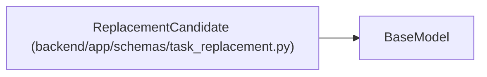

# ReplacementCandidate

**Location:** `backend/app/schemas/task_replacement.py:104`
**Kind:** Pydantic model
**Bases:** `BaseModel`
**Module:** [schemas_task_replacement](../modules/schemas_task_replacement.md)

## Description

The delivered candidate of a replacement task: its base commit, head commit, pull request and digest, as recorded for review.

## Attributes

| Name | Type | Wire name | Required | Nullable | Default | Constraints | Examples | Description |
|------|------|-----------|----------|----------|---------|-------------|-------------|----------|
| `base_commit_url` | `str \| None` | `base_commit_url` | No | Yes | `None` | — | — | — |
| `commit_url` | `str \| None` | `commit_url` | No | Yes | `None` | — | — | — |
| `pr_url` | `str \| None` | `pr_url` | No | Yes | `None` | — | — | — |
| `digest` | `str \| None` | `digest` | No | Yes | `None` | — | — | — |

## Methods

*No declared methods.*

## Relationships

<!-- Auto-generated relationship summary. Do not edit by hand. -->

### Summary

| Module | Methods | Attributes |
|---|---:|---|
| [schemas_task_replacement](../modules/schemas_task_replacement.md) | 0 | `base_commit_url`, `commit_url`, `digest`, `pr_url` |

### Structure

| Kind | Entity | Module |
|---|---|---|
| Base | `BaseModel` | — |
