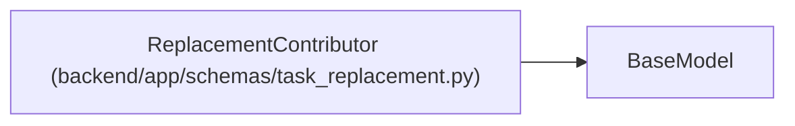

# ReplacementContributor

**Location:** `backend/app/schemas/task_replacement.py:41`
**Kind:** Pydantic model
**Bases:** `BaseModel`
**Module:** [schemas_task_replacement](../modules/schemas_task_replacement.md)

## Description

One recorded attempt with exactly the attribution the server holds for it.

## Attributes

| Name | Type | Wire name | Required | Nullable | Default | Constraints | Examples | Description |
|------|------|-----------|----------|----------|---------|-------------|-------------|----------|
| `run_id` | `int \| None` | `run_id` | No | Yes | `None` | — | — | — |
| `actor_id` | `int \| None` | `actor_id` | No | Yes | `None` | — | — | — |
| `profile_id` | `int \| None` | `profile_id` | No | Yes | `None` | — | — | — |
| `publisher_key` | `str \| None` | `publisher_key` | No | Yes | `None` | — | — | — |
| `commit_urls` | `list[str]` | `commit_urls` | No | No | factory: `list` | — | — | — |
| `missing` | `list[str]` | `missing` | No | No | factory: `list` | — | — | — |
| `attributed` | `bool` | `attributed` | Yes | No | — | — | — | — |
| `carried_from_task_id` | `int \| None` | `carried_from_task_id` | No | Yes | `None` | — | — | — |

## Methods

*No declared methods.*

## Relationships

<!-- Auto-generated relationship summary. Do not edit by hand. -->

### Summary

| Module | Methods | Attributes |
|---|---:|---|
| [schemas_task_replacement](../modules/schemas_task_replacement.md) | 0 | `actor_id`, `attributed`, `carried_from_task_id`, `commit_urls`, `missing`, `profile_id`, `publisher_key`, `run_id` |

### Structure

| Kind | Entity | Module |
|---|---|---|
| Base | `BaseModel` | — |
