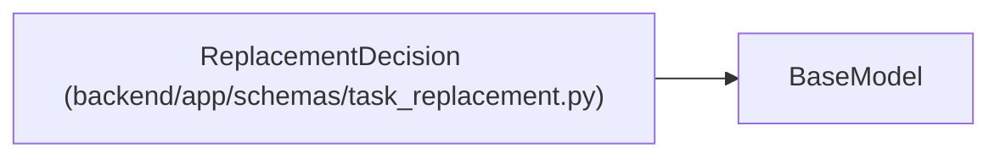

# ReplacementDecision

**Location:** `backend/app/schemas/task_replacement.py:74`
**Kind:** Pydantic model
**Bases:** `BaseModel`
**Module:** [schemas_task_replacement](../modules/schemas_task_replacement.md)

## Description

Who decided a replacement or supersession and why: the reason, the owner's recorded decision where one authorizes a replacement, when it was decided, and the deciding principal or actor.

## Attributes

| Name | Type | Wire name | Required | Nullable | Default | Constraints | Examples | Description |
|------|------|-----------|----------|----------|---------|-------------|-------------|----------|
| `reason` | `str` | `reason` | Yes | No | — | — | — | — |
| `owner_decision` | `str \| None` | `owner_decision` | No | Yes | `None` | — | — | — |
| `decided_at` | `datetime` | `decided_at` | Yes | No | — | — | — | — |
| `decided_by_principal_id` | `int \| None` | `decided_by_principal_id` | No | Yes | `None` | — | — | — |
| `decided_by_actor_id` | `int \| None` | `decided_by_actor_id` | No | Yes | `None` | — | — | — |

## Methods

*No declared methods.*

## Relationships

<!-- Auto-generated relationship summary. Do not edit by hand. -->

### Summary

| Module | Methods | Attributes |
|---|---:|---|
| [schemas_task_replacement](../modules/schemas_task_replacement.md) | 0 | `decided_at`, `decided_by_actor_id`, `decided_by_principal_id`, `owner_decision`, `reason` |

### Structure

| Kind | Entity | Module |
|---|---|---|
| Base | `BaseModel` | — |
