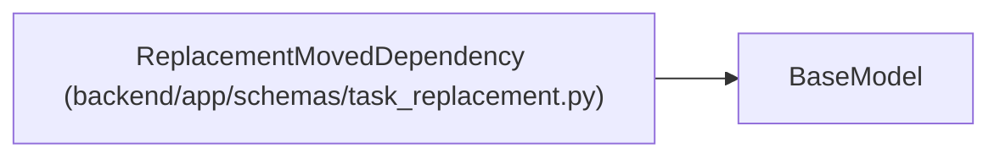

# ReplacementMovedDependency

**Location:** `backend/app/schemas/task_replacement.py:87`
**Kind:** Pydantic model
**Bases:** `BaseModel`
**Module:** [schemas_task_replacement](../modules/schemas_task_replacement.md)

## Description

One thing the disposition moved from the original task to its replacement or successor: a schedule dependency, a delivery prerequisite or a reactivation requirement, and whether it was moved, merged, removed or converted.

## Attributes

| Name | Type | Wire name | Required | Nullable | Default | Constraints | Examples | Description |
|------|------|-----------|----------|----------|---------|-------------|-------------|----------|
| `task_id` | `int` | `task_id` | Yes | No | — | — | — | — |
| `kind` | `Literal['schedule', 'delivery', 'reactivation']` | `kind` | Yes | No | — | — | — | — |
| `action` | `Literal['moved', 'merged', 'removed', 'converted']` | `action` | Yes | No | — | — | — | — |

## Methods

*No declared methods.*

## Relationships

<!-- Auto-generated relationship summary. Do not edit by hand. -->

### Summary

| Module | Methods | Attributes |
|---|---:|---|
| [schemas_task_replacement](../modules/schemas_task_replacement.md) | 0 | `action`, `kind`, `task_id` |

### Structure

| Kind | Entity | Module |
|---|---|---|
| Base | `BaseModel` | — |
