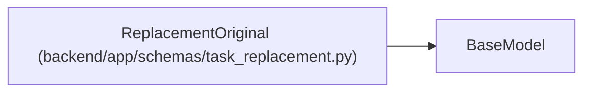

# ReplacementOriginal

**Location:** `backend/app/schemas/task_replacement.py:93`
**Kind:** Pydantic model
**Bases:** `BaseModel`
**Module:** [schemas_task_replacement](../modules/schemas_task_replacement.md)

## Description

_Auto-generated from `ReplacementOriginal` in `backend/app/schemas/task_replacement.py`._

## Attributes

| Name | Type | Wire name | Required | Nullable | Default | Constraints | Examples | Description |
|------|------|-----------|----------|----------|---------|-------------|-------------|----------|
| `task_id` | `int` | `task_id` | Yes | No | — | — | — | — |
| `status` | `str` | `status` | Yes | No | — | — | — | — |
| `canceled` | `bool` | `canceled` | Yes | No | — | — | — | — |
| `independently_accepted` | `Literal[False]` | `independently_accepted` | No | No | `False` | — | — | — |
| `status_at_decision` | `str` | `status_at_decision` | Yes | No | — | — | — | — |
| `version_at_decision` | `int` | `version_at_decision` | Yes | No | — | — | — | — |
| `attempts` | `list[ReplacementContributor]` | `attempts` | Yes | No | — | — | — | — |
| `unattributed_run_ids` | `list[int]` | `unattributed_run_ids` | Yes | No | — | — | — | — |

## Methods

*No declared methods.*

## Relationships

<!-- Auto-generated relationship summary. Do not edit by hand. -->

### Summary

| Module | Methods | Attributes |
|---|---:|---|
| [schemas_task_replacement](../modules/schemas_task_replacement.md) | 0 | `attempts`, `canceled`, `independently_accepted`, `status`, `status_at_decision`, `task_id`, `unattributed_run_ids`, `version_at_decision` |

### Structure

| Kind | Entity | Module |
|---|---|---|
| Base | `BaseModel` | — |
