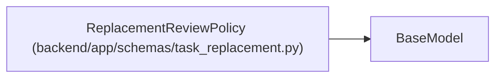

# ReplacementReviewPolicy

**Location:** `backend/app/schemas/task_replacement.py:82`
**Kind:** Pydantic model
**Bases:** `BaseModel`
**Module:** [schemas_task_replacement](../modules/schemas_task_replacement.md)

## Description

The project's different-review-publisher policy as it applied when the disposition was recorded and as it applies now, so a held replacement can be judged against the policy that was in force.

## Attributes

| Name | Type | Wire name | Required | Nullable | Default | Constraints | Examples | Description |
|------|------|-----------|----------|----------|---------|-------------|-------------|----------|
| `require_different_review_publisher_at_decision` | `bool` | `require_different_review_publisher_at_decision` | Yes | No | — | — | — | — |
| `require_different_review_publisher` | `bool` | `require_different_review_publisher` | Yes | No | — | — | — | — |

## Methods

*No declared methods.*

## Relationships

<!-- Auto-generated relationship summary. Do not edit by hand. -->

### Summary

| Module | Methods | Attributes |
|---|---:|---|
| [schemas_task_replacement](../modules/schemas_task_replacement.md) | 0 | `require_different_review_publisher`, `require_different_review_publisher_at_decision` |

### Structure

| Kind | Entity | Module |
|---|---|---|
| Base | `BaseModel` | — |
