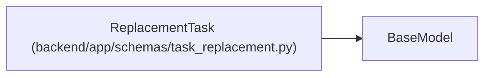

# ReplacementTask

**Location:** `backend/app/schemas/task_replacement.py:111`
**Kind:** Pydantic model
**Bases:** `BaseModel`
**Module:** [schemas_task_replacement](../modules/schemas_task_replacement.md)

## Description

_Auto-generated from `ReplacementTask` in `backend/app/schemas/task_replacement.py`._

## Attributes

| Name | Type | Wire name | Required | Nullable | Default | Constraints | Examples | Description |
|------|------|-----------|----------|----------|---------|-------------|-------------|----------|
| `task_id` | `int` | `task_id` | Yes | No | — | — | — | — |
| `status` | `str` | `status` | Yes | No | — | — | — | — |
| `accepted` | `bool` | `accepted` | Yes | No | — | — | — | — |
| `recorded_base_commit_url` | `str \| None` | `recorded_base_commit_url` | No | Yes | `None` | — | — | — |
| `candidate` | `ReplacementCandidate \| None` | `candidate` | No | Yes | `None` | — | — | — |
| `contributors` | `list[ReplacementContributor]` | `contributors` | Yes | No | — | — | — | — |

## Methods

*No declared methods.*

## Relationships

<!-- Auto-generated relationship summary. Do not edit by hand. -->

### Summary

| Module | Methods | Attributes |
|---|---:|---|
| [schemas_task_replacement](../modules/schemas_task_replacement.md) | 0 | `accepted`, `candidate`, `contributors`, `recorded_base_commit_url`, `status`, `task_id` |

### Structure

| Kind | Entity | Module |
|---|---|---|
| Base | `BaseModel` | — |
