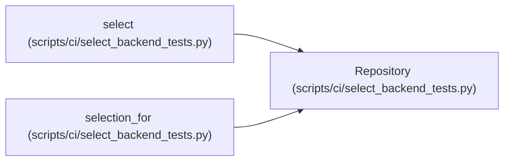

# Repository

**Location:** `scripts/ci/select_backend_tests.py:299`
**Kind:** Class
**Bases:** —
**Module:** [select_backend_tests](../modules/select_backend_tests.md)

## Description

The Python files of the head checkout and how they depend on each other.

## Attributes

*No annotated attributes found.*

## Methods

| Method | Signature | Decorators | Description |
|--------|-----------|------------|-------------|
| `__init__` | `(root: Path, files: Iterable[str] \| None = None) -> None` | — | — |
| `_resolve` | `(tree: ast.AST, path: str) -> set[str]` | — | — |
| `needles` | `(path: str) -> list[tuple[str, ...]]` | — | Return word groups; a file mentions ``path`` when it has all of a group. |
| `mentioning` | `(path: str) -> set[str]` | — | Return the Python files whose source mentions ``path``. |
| `dependents` | `(path: str) -> set[str]` | — | — |
| `affected` | `(paths: Iterable[str]) -> set[str]` | — | Return every Python file that depends, transitively, on a path. |

## Relationships

<!-- Auto-generated relationship summary. Do not edit by hand. -->

### Summary

| Module | Methods | Attributes |
|---|---:|---|
| [select_backend_tests](../modules/select_backend_tests.md) | 6 | — |

### References

| Reference | Kind | Source | Call sites |
|---|---|---|---:|
| `select` | call | [select_backend_tests](../modules/select_backend_tests.md) | 1 |
| `selection_for` | type_reference | [select_backend_tests](../modules/select_backend_tests.md) | — |
