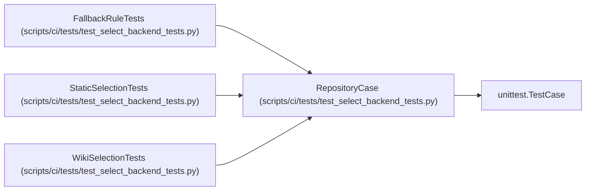

# RepositoryCase

**Location:** `scripts/ci/tests/test_select_backend_tests.py:79`
**Kind:** Class
**Bases:** `unittest.TestCase`
**Module:** [test_select_backend_tests](../modules/test_select_backend_tests.md)

## Description

_Auto-generated from `RepositoryCase` in `scripts/ci/tests/test_select_backend_tests.py`._

## Attributes

*No annotated attributes found.*

## Methods

| Method | Signature | Decorators | Description |
|--------|-----------|------------|-------------|
| `setUp` | `() -> None` | — | — |
| `tearDown` | `() -> None` | — | — |
| `change` | `(files: dict[str, str]) -> str` | — | — |
| `select` | `(head: str, **kwargs)` | — | — |

## Relationships

<!-- Auto-generated relationship summary. Do not edit by hand. -->

### Summary

| Module | Methods | Attributes |
|---|---:|---|
| [test_select_backend_tests](../modules/test_select_backend_tests.md) | 4 | — |

### Structure

| Kind | Entity | Module |
|---|---|---|
| Base | `unittest.TestCase` | — |
| Subclass | `FallbackRuleTests` | [test_select_backend_tests](../modules/test_select_backend_tests.md) |
| Subclass | `StaticSelectionTests` | [test_select_backend_tests](../modules/test_select_backend_tests.md) |
| Subclass | `WikiSelectionTests` | [test_select_backend_tests](../modules/test_select_backend_tests.md) |
