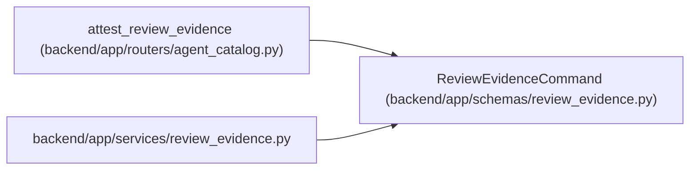

# ReviewEvidenceCommand

**Location:** `backend/app/schemas/review_evidence.py:64`
**Kind:** Type alias
**Bases:** —
**Module:** [schemas_review_evidence](../modules/schemas_review_evidence.md)
**Target:** `Annotated[ReviewEvidenceIssue \| ReviewEvidenceRevocation, Field(discriminator='action')]`

## Description

_Auto-generated from `ReviewEvidenceCommand` in `backend/app/schemas/review_evidence.py`._

## Attributes

*See the alias definition for its member types.*

## Methods

*See the alias definition for callable and member types.*

## Relationships

<!-- Auto-generated relationship summary. Do not edit by hand. -->

### Summary

| Module | Methods | Attributes |
|---|---:|---|
| [schemas_review_evidence](../modules/schemas_review_evidence.md) | 0 | — |

### References

| Reference | Kind | Source | Call sites |
|---|---|---|---:|
| `attest_review_evidence` | type_reference | [agent_catalog](../modules/agent_catalog.md) | — |
| `review_evidence` | import | [services_review_evidence](../modules/services_review_evidence.md) | — |
