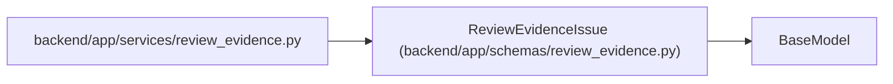

# ReviewEvidenceIssue

**Location:** `backend/app/schemas/review_evidence.py:31`
**Kind:** Pydantic model
**Bases:** `BaseModel`
**Module:** [schemas_review_evidence](../modules/schemas_review_evidence.md)

## Description

The operator attests to the manifest of material delivered to the specified verifier.

The operator identifies the exact current assessment and task, brief, artifact and binding revisions. A source-and-tests packet must contain distinct named results. Both issue forms include the digest of the exact delivered bytes and an offset-aware expiry.

## Model Configuration

| Setting | Value | Source |
|---------|-------|--------|
| `extra` | `'forbid'` | model_config |

## Validators

| Method | Scope | Fields | Mode | Options |
|--------|-------|--------|------|---------|
| `check_evidence_set` | model | — | after | — |

## Attributes

| Name | Type | Wire name | Required | Nullable | Default | Constraints | Examples | Description |
|------|------|-----------|----------|----------|---------|-------------|-------------|----------|
| `action` | `Literal['issue']` | `action` | Yes | No | — | — | — | — |
| `expected_task_version` | `Positive` | `expected_task_version` | Yes | No | — | — | — | — |
| `expected_assessment_id` | `Positive` | `expected_assessment_id` | Yes | No | — | — | — | — |
| `expected_brief_revision` | `Annotated[int, Field(strict=True, ge=0)]` | `expected_brief_revision` | Yes | No | — | ge=0; strict=True | — | — |
| `expected_artifact_revision` | `Annotated[int, Field(strict=True, ge=0)]` | `expected_artifact_revision` | Yes | No | — | ge=0; strict=True | — | — |
| `commit_sha` | `str` | `commit_sha` | Yes | No | — | pattern='^[0-9a-f]{40}$' | — | — |
| `reviewer_actor_id` | `Positive` | `reviewer_actor_id` | Yes | No | — | — | — | — |
| `binding_id` | `Positive` | `binding_id` | Yes | No | — | — | — | — |
| `expected_binding_revision` | `Positive` | `expected_binding_revision` | Yes | No | — | — | — | — |
| `method` | `Literal['source_only', 'source_and_tests']` | `method` | Yes | No | — | — | — | — |
| `packet_sha256` | `Sha256` | `packet_sha256` | Yes | No | — | — | — | — |
| `tests` | `list[ReviewTestEvidence]` | `tests` | No | No | factory: `list` | max_length=32 | — | — |
| `expires_at` | `AwareDatetime` | `expires_at` | Yes | No | — | — | — | — |

## Methods

| Method | Signature | Decorators | Description |
|--------|-----------|------------|-------------|
| `check_evidence_set` | `()` | `@model_validator(mode='after')` | — |

## Relationships

<!-- Auto-generated relationship summary. Do not edit by hand. -->

### Summary

| Module | Methods | Attributes |
|---|---:|---|
| [schemas_review_evidence](../modules/schemas_review_evidence.md) | 1 | `action`, `binding_id`, `commit_sha`, `expected_artifact_revision`, `expected_assessment_id`, `expected_binding_revision`, `expected_brief_revision`, `expected_task_version`, `expires_at`, `method`, `packet_sha256`, `reviewer_actor_id` |

### Structure

| Kind | Entity | Module |
|---|---|---|
| Base | `BaseModel` | — |

### References

| Reference | Kind | Source | Call sites |
|---|---|---|---:|
| `review_evidence` | import | [services_review_evidence](../modules/services_review_evidence.md) | — |
