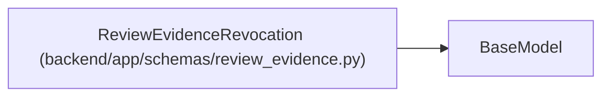

# ReviewEvidenceRevocation

**Location:** `backend/app/schemas/review_evidence.py:58`
**Kind:** Pydantic model
**Bases:** `BaseModel`
**Module:** [schemas_review_evidence](../modules/schemas_review_evidence.md)

## Description

_Auto-generated from `ReviewEvidenceRevocation` in `backend/app/schemas/review_evidence.py`._

Revocation identifies a particular issued receipt on the same task. Its audit record prevents later selection or verdicts with that receipt, including when the verifier already holds the assignment.

## Model Configuration

| Setting | Value | Source |
|---------|-------|--------|
| `extra` | `'forbid'` | model_config |

## Attributes

| Name | Type | Wire name | Required | Nullable | Default | Constraints | Examples | Description |
|------|------|-----------|----------|----------|---------|-------------|-------------|----------|
| `action` | `Literal['revoke']` | `action` | Yes | No | — | — | — | — |
| `evidence_id` | `Positive` | `evidence_id` | Yes | No | — | — | — | — |

## Methods

*No declared methods.*

## Relationships

<!-- Auto-generated relationship summary. Do not edit by hand. -->

### Summary

| Module | Methods | Attributes |
|---|---:|---|
| [schemas_review_evidence](../modules/schemas_review_evidence.md) | 0 | `action`, `evidence_id` |

### Structure

| Kind | Entity | Module |
|---|---|---|
| Base | `BaseModel` | — |
