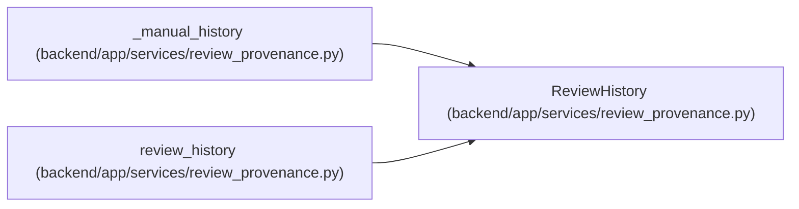

# ReviewHistory

**Location:** `backend/app/services/review_provenance.py:513`
**Kind:** Class
**Bases:** —
**Module:** [review_provenance](../modules/review_provenance.md)

**Decorators:** `@dataclass`

## Description

_Auto-generated from `ReviewHistory` in `backend/app/services/review_provenance.py`._

## Attributes

| Name | Type | Default | Description |
|------|------|---------|-------------|
| `contributors` | `list[dict]` | *required* | — |
| `candidate` | `dict \| None` | *required* | — |
| `manual_execution` | `dict \| None` | `None` | — |
| `missing_manual_fact` | `str \| None` | `None` | — |
| `required_reviewer_profiles` | `tuple[int, ...] \| None` | `None` | — |

## Methods

| Method | Signature | Decorators | Description |
|--------|-----------|------------|-------------|
| `permits_profile` | `(profile_id)` | — | — |
| `publisher_blockers` | `(publisher)` | — | — |

## Relationships

<!-- Auto-generated relationship summary. Do not edit by hand. -->

### Summary

| Module | Methods | Attributes |
|---|---:|---|
| [review_provenance](../modules/review_provenance.md) | 2 | `candidate`, `contributors`, `manual_execution`, `missing_manual_fact`, `required_reviewer_profiles` |

### References

| Reference | Kind | Source | Call sites |
|---|---|---|---:|
| `_manual_history` | call | [review_provenance](../modules/review_provenance.md) | 13 |
| `review_history` | call | [review_provenance](../modules/review_provenance.md) | 4 |
