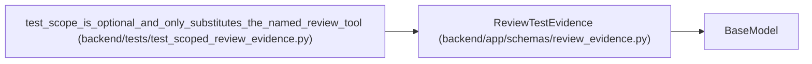

# ReviewTestEvidence

**Location:** `backend/app/schemas/review_evidence.py:18`
**Kind:** Pydantic model
**Bases:** `BaseModel`
**Module:** [schemas_review_evidence](../modules/schemas_review_evidence.md)

## Description

_Auto-generated from `ReviewTestEvidence` in `backend/app/schemas/review_evidence.py`._

A relative test identifier and result digest let the reviewer compare the operator's record with the exact test output it received.

## Model Configuration

| Setting | Value | Source |
|---------|-------|--------|
| `extra` | `'forbid'` | model_config |

## Validators

| Method | Scope | Fields | Mode | Options |
|--------|-------|--------|------|---------|
| `require_local_identifier` | field | name | after | — |

## Attributes

| Name | Type | Wire name | Required | Nullable | Default | Constraints | Examples | Description |
|------|------|-----------|----------|----------|---------|-------------|-------------|----------|
| `name` | `str` | `name` | Yes | No | — | min_length=1; max_length=180; pattern='^[A-Za-z0-9_][A-Za-z0-9_.:/-]*$' | — | — |
| `result_sha256` | `Sha256` | `result_sha256` | Yes | No | — | — | — | — |

## Methods

| Method | Signature | Decorators | Description |
|--------|-----------|------------|-------------|
| `require_local_identifier` | `(name)` | `@field_validator('name')`, `@classmethod` | — |

## Relationships

<!-- Auto-generated relationship summary. Do not edit by hand. -->

### Summary

| Module | Methods | Attributes |
|---|---:|---|
| [schemas_review_evidence](../modules/schemas_review_evidence.md) | 1 | `name`, `result_sha256` |

### Structure

| Kind | Entity | Module |
|---|---|---|
| Base | `BaseModel` | — |

### References

| Reference | Kind | Source | Call sites |
|---|---|---|---:|
| `test_scope_is_optional_and_only_substitutes_the_named_review_tool` | call | [test_scoped_review_evidence](../modules/test_scoped_review_evidence.md) | 1 |
