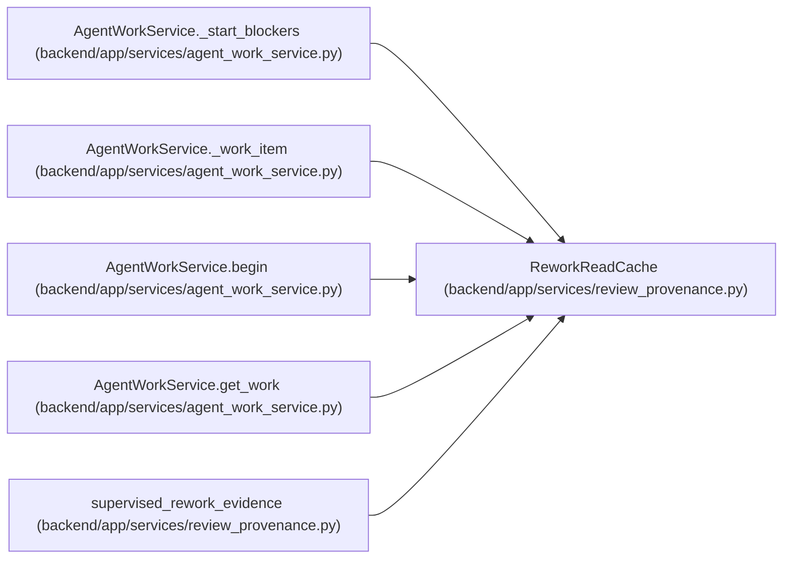

# ReworkReadCache

**Location:** `backend/app/services/review_provenance.py:50`
**Kind:** Class
**Bases:** —
**Module:** [review_provenance](../modules/review_provenance.md)

**Decorators:** `@dataclass`

## Description

Ephemeral evidence for one queue/context request or one locked begin transaction.

Several assignments on one queue page can reuse the same team and binding observations. A new request reads current state again. Worker begin obtains a fresh locked proof, which it reuses only within that transaction.

## Attributes

| Name | Type | Default | Description |
|------|------|---------|-------------|
| `assignments` | `dict` | `field(default_factory=dict)` | — |
| `projects` | `dict` | `field(default_factory=dict)` | — |
| `teams` | `dict` | `field(default_factory=dict)` | — |
| `bindings` | `dict` | `field(default_factory=dict)` | — |
| `modes` | `dict` | `field(default_factory=dict)` | — |
| `retained_outputs` | `dict` | `field(default_factory=dict)` | — |

## Methods

*No declared methods.*

## Relationships

<!-- Auto-generated relationship summary. Do not edit by hand. -->

### Summary

| Module | Methods | Attributes |
|---|---:|---|
| [review_provenance](../modules/review_provenance.md) | 0 | `assignments`, `bindings`, `modes`, `projects`, `retained_outputs`, `teams` |

### References

| Reference | Kind | Source | Call sites |
|---|---|---|---:|
| `AgentWorkService._start_blockers` | call | [agent_work_service](../modules/agent_work_service.md) | 1 |
| `AgentWorkService._start_blockers` | type_reference | [agent_work_service](../modules/agent_work_service.md) | — |
| `AgentWorkService._work_item` | type_reference | [agent_work_service](../modules/agent_work_service.md) | — |
| `AgentWorkService.begin` | call | [agent_work_service](../modules/agent_work_service.md) | 1 |
| `AgentWorkService.get_work` | call | [agent_work_service](../modules/agent_work_service.md) | 1 |
| `AgentWorkService.get_work` | type_reference | [agent_work_service](../modules/agent_work_service.md) | — |
| `supervised_rework_evidence` | call | [review_provenance](../modules/review_provenance.md) | 1 |
