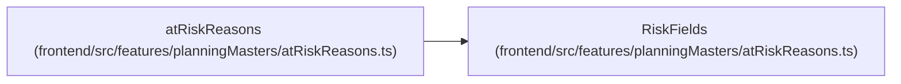

# RiskFields

**Location:** `frontend/src/features/planningMasters/atRiskReasons.ts:6`
**Kind:** Type alias
**Bases:** —
**Module:** [atRiskReasons](../modules/atRiskReasons.md)
**Target:**

```typescript
Pick<Task, 'is_overdue' | 'is_delayed' | 'is_outside_constraints'>
    & Partial<Pick<Task, 'start_date' | 'end_date' | 'min_start_date' | 'max_end_date' | 'actual_start_date' | 'baseline_start_date'>>
```

## Description

_Auto-generated from `RiskFields` in `frontend/src/features/planningMasters/atRiskReasons.ts`._

## Attributes

*See the alias definition for its member types.*

## Methods

*See the alias definition for callable and member types.*

## Relationships

<!-- Auto-generated relationship summary. Do not edit by hand. -->


### Summary

| Module | Methods | Attributes |
|---|---:|---|
| [atRiskReasons](../modules/atRiskReasons.md) | 0 | — |

### References

| Reference | Kind | Source | Call sites |
|---|---|---|---:|
| `atRiskReasons` | type_reference | [atRiskReasons](../modules/atRiskReasons.md) | — |
