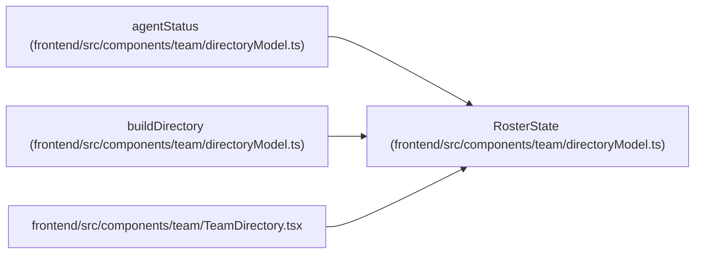

# RosterState

**Location:** `frontend/src/components/team/directoryModel.ts:13`
**Kind:** Type alias
**Bases:** —
**Module:** [directoryModel](../modules/directoryModel.md)
**Target:**

```typescript
'loaded' | 'loading' | 'unavailable'
```

## Description

Loaded: the roster was read in this request. Loading: the first read is under way. Unavailable: no key, or the read failed.

## Attributes

*See the alias definition for its member types.*

## Methods

*See the alias definition for callable and member types.*

## Relationships

<!-- Auto-generated relationship summary. Do not edit by hand. -->


### Summary

| Module | Methods | Attributes |
|---|---:|---|
| [directoryModel](../modules/directoryModel.md) | 0 | — |

### References

| Reference | Kind | Source | Call sites |
|---|---|---|---:|
| `agentStatus` | type_reference | [directoryModel](../modules/directoryModel.md) | — |
| `buildDirectory` | type_reference | [directoryModel](../modules/directoryModel.md) | — |
| `TeamDirectory` | import | [TeamDirectory](../modules/TeamDirectory.md) | — |
