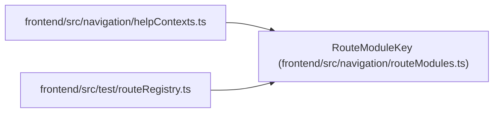

# RouteModuleKey

**Location:** `frontend/src/navigation/routeModules.ts:24`
**Kind:** Type alias
**Bases:** —
**Module:** [routeModules](../modules/routeModules.md)
**Target:**

```typescript
keyof typeof routeModuleLoaders
```

## Description

_Auto-generated from `RouteModuleKey` in `frontend/src/navigation/routeModules.ts`._

## Attributes

*See the alias definition for its member types.*

## Methods

*See the alias definition for callable and member types.*

## Relationships

<!-- Auto-generated relationship summary. Do not edit by hand. -->


### Summary

| Module | Methods | Attributes |
|---|---:|---|
| [routeModules](../modules/routeModules.md) | 0 | — |

### References

| Reference | Kind | Source | Call sites |
|---|---|---|---:|
| `helpContexts` | import | [helpContexts](../modules/helpContexts.md) | — |
| `routeRegistry` | import | [routeRegistry](../modules/routeRegistry.md) | — |
