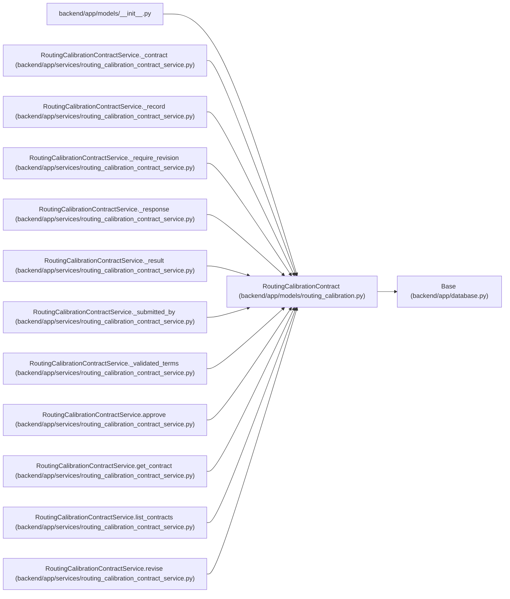

# RoutingCalibrationContract

**Location:** `backend/app/models/routing_calibration.py:29`
**Kind:** Class
**Bases:** `Base`
**Module:** [models_routing_calibration](../modules/models_routing_calibration.md)

## Description

The current revision of one named calibration contract.

Its terms are complete on every revision. Submitting new terms makes the
contract ``submitted`` again, so an approval always covers exactly the
terms the approver read.

## Attributes

| Name | Type | Default | Description |
|------|------|---------|-------------|
| `id` | `Mapped[int]` | `mapped_column(Integer, primary_key=True, autoincrement=True)` | — |
| `key` | `Mapped[str]` | `mapped_column(String(120), nullable=False)` | — |
| `schema_version` | `Mapped[str]` | `mapped_column(String(60), nullable=False)` | — |
| `state` | `Mapped[str]` | `mapped_column(String(20), default='submitted', nullable=False)` | — |
| `revision` | `Mapped[int]` | `mapped_column(Integer, default=1, nullable=False)` | — |
| `terms` | `Mapped[dict[str, Any]]` | `mapped_column(JSON, nullable=False)` | — |
| `terms_digest` | `Mapped[str]` | `mapped_column(String(64), nullable=False)` | — |
| `submitted_by_actor_type` | `Mapped[str]` | `mapped_column(String(50), nullable=False)` | — |
| `submitted_by_actor_id` | `Mapped[Optional[int]]` | `mapped_column(Integer, ForeignKey('agent_actors.id'), nullable=True)` | — |
| `submitted_at` | `Mapped[datetime]` | `mapped_column(UTCDateTime(), default=utc_now, nullable=False)` | — |
| `approved_by_actor_type` | `Mapped[Optional[str]]` | `mapped_column(String(50), nullable=True)` | — |
| `approved_by_actor_id` | `Mapped[Optional[int]]` | `mapped_column(Integer, ForeignKey('agent_actors.id'), nullable=True)` | — |
| `approved_at` | `Mapped[Optional[datetime]]` | `mapped_column(UTCDateTime(), nullable=True)` | — |
| `approval_reason` | `Mapped[Optional[str]]` | `mapped_column(Text, nullable=True)` | — |
| `approved_as` | `Mapped[Optional[str]]` | `mapped_column(String(255), nullable=True)` | — |
| `created_at` | `Mapped[datetime]` | `mapped_column(UTCDateTime(), default=utc_now, nullable=False)` | — |
| `updated_at` | `Mapped[datetime]` | `mapped_column(UTCDateTime(), default=utc_now, onupdate=utc_now, nullable=False)` | — |
| `revisions` | `Mapped[list['RoutingCalibrationContractRevision']]` | `relationship('RoutingCalibrationContractRevision', back_populates='contract', order_by='RoutingCalibrationContractRevision.revision')` | — |

## Methods

*No declared methods.*

## Relationships

<!-- Auto-generated relationship summary. Do not edit by hand. -->

### Summary

| Module | Methods | Attributes |
|---|---:|---|
| [models_routing_calibration](../modules/models_routing_calibration.md) | 0 | `approval_reason`, `approved_as`, `approved_at`, `approved_by_actor_id`, `approved_by_actor_type`, `created_at`, `id`, `key`, `revision`, `revisions`, `schema_version`, `state` |

### Structure

| Kind | Entity | Module |
|---|---|---|
| Base | `Base` | [app_database](../modules/app_database.md) |

### References

| Reference | Kind | Source | Call sites |
|---|---|---|---:|
| `__init__` | import | [models___init__](../modules/models___init__.md) | — |
| `RoutingCalibrationContractService._contract` | type_reference | [routing_calibration_contract_service](../modules/routing_calibration_contract_service.md) | — |
| `RoutingCalibrationContractService._record` | type_reference | [routing_calibration_contract_service](../modules/routing_calibration_contract_service.md) | — |
| `RoutingCalibrationContractService._require_revision` | type_reference | [routing_calibration_contract_service](../modules/routing_calibration_contract_service.md) | — |
| `RoutingCalibrationContractService._response` | type_reference | [routing_calibration_contract_service](../modules/routing_calibration_contract_service.md) | — |
| `RoutingCalibrationContractService._result` | type_reference | [routing_calibration_contract_service](../modules/routing_calibration_contract_service.md) | — |
| `RoutingCalibrationContractService._submitted_by` | type_reference | [routing_calibration_contract_service](../modules/routing_calibration_contract_service.md) | — |
| `RoutingCalibrationContractService._validated_terms` | type_reference | [routing_calibration_contract_service](../modules/routing_calibration_contract_service.md) | — |
| `RoutingCalibrationContractService.approve` | type_reference | [routing_calibration_contract_service](../modules/routing_calibration_contract_service.md) | — |
| `RoutingCalibrationContractService.get_contract` | type_reference | [routing_calibration_contract_service](../modules/routing_calibration_contract_service.md) | — |
| `RoutingCalibrationContractService.list_contracts` | type_reference | [routing_calibration_contract_service](../modules/routing_calibration_contract_service.md) | — |
| `RoutingCalibrationContractService.revise` | type_reference | [routing_calibration_contract_service](../modules/routing_calibration_contract_service.md) | — |

> References: showing 12 of 16 logical references; 4 omitted by the 12-row generated summary limit.
